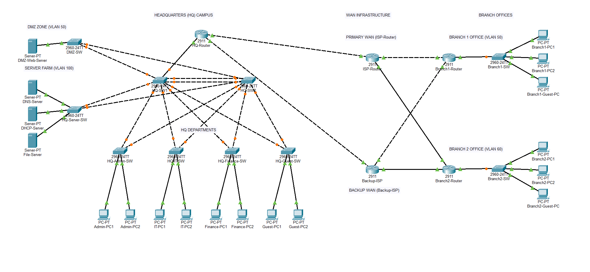
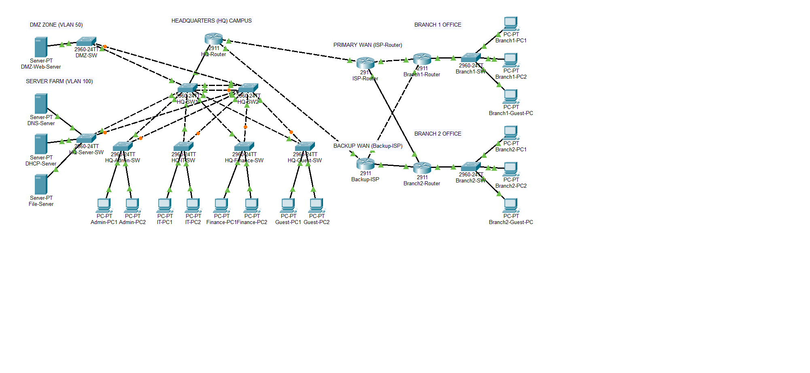
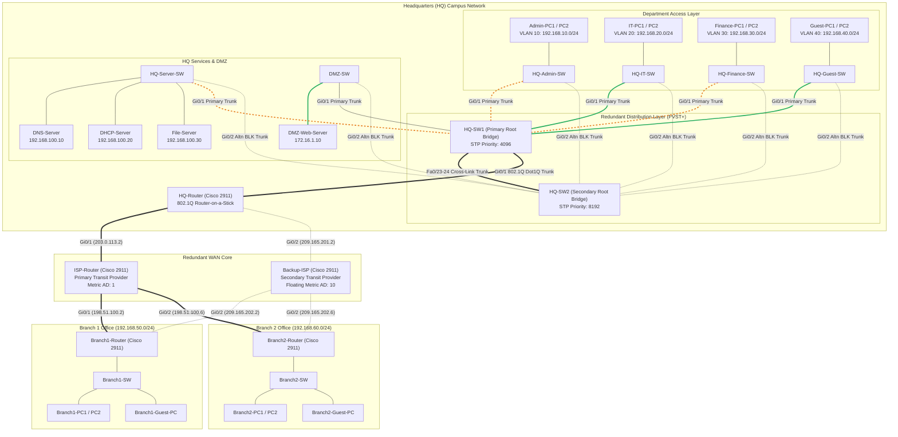

# 🛡️ Secure Multi-Branch Enterprise Network & High-Performance LAN Infrastructure
## Site-to-Site IPsec VPN, VLANs, Extended ACLs, Redundant Dual-WAN Failover & PVST+ Loop Prevention
### Computer Networks (CN) Capstone / B.Tech Engineering Final Project

[](https://www.netacad.com/courses/packet-tracer)
[](#-site-to-site-ipsec-vpn-architecture)
[](#-redundant-wan-architecture--failover-mechanism)
[](#-site-to-site-ipsec-vpn-architecture)
[](#-security-implementation--access-control-lists)
[](#-lan-redundancy--spanning-tree-protocol-pvst)
[](#-empirical-verification--testing-results)
[](LICENSE)

---

## 📖 Executive Summary & Project Evolution

In modern enterprise and commercial networking, infrastructure must simultaneously fulfill local segmentation demands and secure wide-area interconnectivity across untrusted public Internet Service Provider (ISP) backbones. 

This repository documents the end-to-end design, implementation, and empirical verification of a scalable network architecture developed across three evolutionary phases in **Cisco Packet Tracer 9.0 / 8.x**:

```
┌─────────────────────────────────┐     ┌──────────────────────────────────┐     ┌─────────────────────────────────────┐
│  Phase 1: Internet Cafe & LAN   │ ──► │  Phase 2: Multi-Branch IPsec VPN │ ──► │  Phase 3: High-Availability Campus  │
│  • Commercial Subnetting (VLSM) │     │  • Headquarter & Branch Sites    │     │  • Dual-ISP Redundant WAN Failover  │
│  • 802.1Q VLANs & NAT Overload  │     │  • AES-128 / SHA-1 Crypto Tunnels│     │  • PVST+ Root Bridge Distribution   │
│  • DHCP Server Pools & ACLs     │     │  • Extended Role-Based ACLs      │     │  • Isolated DMZ & Central Services  │
└─────────────────────────────────┘     └──────────────────────────────────┘     └─────────────────────────────────────┘
```

---

## 📦 Master Deliverables & Navigation

### 🎯 Cisco Packet Tracer Topology Models (`.pkt`)
| Model File | Milestone / Edition | Description |
| :--- | :--- | :--- |
| **[`Secure_MultiBranch_Enterprise_Network_Presentation_Final.pkt`](Secure_MultiBranch_Enterprise_Network_Presentation_Final.pkt)** | **Presentation Edition (Recommended)** | Fully color-coded departmental zones, labeled network subnets, active PVST+ links, dual-ISP WAN, and DMZ. Ideal for evaluation panels and live demos. |
| **[`Secure_MultiBranch_Enterprise_Network_Final.pkt`](Secure_MultiBranch_Enterprise_Network_Final.pkt)** | **Production Master Edition** | Complete enterprise topology with all 36 devices, verified IPsec tunnels, and automated failover scripts. |
| **[`Secure_MultiBranch_IPsec_VPN.pkt`](Secure_MultiBranch_IPsec_VPN.pkt)** | **Major/Minor Review Edition** | Dedicated dual-branch IPsec VPN and WAN failover verification model. |
| **[`Internet_Cafe_Scalable_Network_Design.pkt`](Internet_Cafe_Scalable_Network_Design.pkt)** | **Scalable Cafe Edition** | Expanded commercial internet cafe layout with customer, gaming, admin, and server tiers. |
| **[`Internet-Cafe-Network-Design.pkt`](Internet-Cafe-Network-Design.pkt)** | **Foundational Edition** | Initial core prototype demonstrating 802.1Q VLAN trunking and Cisco IOS NAT/PAT. |

### 📚 Comprehensive Documentation Suite
- 📋 **[Live Demonstration Guide (`docs/PROJECT_DEMONSTRATION_GUIDE.md`)](docs/PROJECT_DEMONSTRATION_GUIDE.md):** 7-stage step-by-step verification script designed for viva and live lab demonstrations.
- 🎓 **[Comprehensive Viva Guide (`docs/PROJECT_VIVA_GUIDE.md`)](docs/PROJECT_VIVA_GUIDE.md):** Deep-dive theoretical primer with 25 technical Q&A covering IPsec, IKE, PVST+, OSPF, and NAT.
- 🧪 **[Empirical Verification Evidence (`docs/VERIFICATION_EVIDENCE.md`)](docs/VERIFICATION_EVIDENCE.md):** Full CLI test captures, ping matrices, and packet trace verifications (Tests 1–12).
- 🔄 **[WAN Failover & VPN Recovery Evidence (`docs/FAILOVER_VPN_RECOVERY_EVIDENCE.md`)](docs/FAILOVER_VPN_RECOVERY_EVIDENCE.md):** Empirical proof of sub-second WAN link failover and automated crypto-map migration.
- 📐 **[Technical Architecture & VLSM Specification (`docs/NETWORK_ARCHITECTURE.md`)](docs/NETWORK_ARCHITECTURE.md):** Detailed addressing tables, subnet masks, and broadcast domain boundaries.
- 🛠️ **[Troubleshooting & Diagnostics Guide (`docs/TROUBLESHOOTING_GUIDE.md`)](docs/TROUBLESHOOTING_GUIDE.md):** IOS debugging commands, common misconfiguration resolutions, and validation checklists.
- ⚙️ **[Device Running Configurations (`configs/`)](configs/):** Direct, copy-pasteable startup and running configurations for all 15 routers and switches.

---

## 🌟 Core Technical Architecture & Features

### 1. Departmental VLAN Segmentation (802.1Q)
- **Isolated Broadcast Domains:** Segmented into Administration (`VLAN 10`), IT Engineering (`VLAN 20`), Finance (`VLAN 30`), and Guest Access (`VLAN 40`).
- **Server Farm & DMZ:** Dedicated Server Farm (`VLAN 100`) and Demilitarized Zone (`VLAN 50`) separated by line-rate Layer 3 gateway boundaries.

### 2. Router-on-a-Stick (ROAS) Inter-VLAN Routing
- 802.1Q subinterfaces configured on `HQ-Router` (`Gi0/0.10` through `Gi0/0.100`) providing line-rate routing, default gateway services, and traffic policy inspection.

### 3. Centralized Enterprise Services (DHCP Relay & DNS)
- **DHCP Relay:** Configured using `ip helper-address 192.168.100.20`, allowing hosts across all departmental VLANs to receive dynamic IP leases from a centralized server.
- **Authoritative DNS:** Corporate domain resolution (`web.corp.local`, `enterprise.corp`, `fileserver.corp.local`) hosted on `192.168.100.10`.

### 4. Isolated Demilitarized Zone (DMZ)
- Publicly accessible DMZ Web Server (`172.16.1.10`) reachable by internal corporate hosts, branch offices, and external clients.
- Gateway security rules prevent DMZ hosts from initiating unprompted sessions into internal corporate VLANs.

### 5. Site-to-Site IPsec VPN Tunnels
- **Confidential Inter-Branch Backhaul:** Connects Headquarters to `Branch 1` and `Branch 2` over public untrusted WAN circuits.
- **IKE Phase 1 (ISAKMP):** `AES-128`, SHA-1 HMAC, Diffie-Hellman Group 2, Pre-Shared Key (`ciscoVPN2026`), reaching confirmed `QM_IDLE ACTIVE` state.
- **IKE Phase 2 (IPsec):** Transform-set `esp-aes esp-sha-hmac` running in IPsec Tunnel Mode with mirrored crypto access lists.

### 6. High-Availability Dual-WAN Redundancy & Automated Failover
- **Dual-Homed WAN:** Primary connection via `ISP-Router` paired with a secondary circuit via `Backup-ISP`.
- **Floating Static Routes:** Primary static default route (Administrative Distance `1`) paired with floating backup route (Administrative Distance `10`).
- **Autonomous Recovery:** Instant failover upon physical carrier-detect change, and automatic state pre-emption when the primary link is restored.
- **Multi-WAN Crypto Binding:** Secondary crypto map sets (`VPN-BACKUP`) bound to backup WAN interfaces (`Gi0/2`), preserving encrypted tunnels during ISP outages.

### 7. Per-VLAN Spanning Tree Plus (PVST+) Layer 2 Redundancy
- Eliminates Layer 2 switching loops while ensuring deterministic uplink utilization.
- Primary Root Bridge on `HQ-SW1` (`spanning-tree vlan 1-100 priority 4096`).
- Secondary Root Bridge on `HQ-SW2` (`spanning-tree vlan 1-100 priority 8192`).
- Access switch distribution uplinks deterministically balance active Root Forwarding (`Root FWD`) and Alternate Blocking (`Altn BLK`) states.

### 8. Granular Extended Access Control Lists (ACLs)
- Gateway-level ingress filtering enforcing zero-trust guest isolation across HQ, Branch 1, and Branch 2 with verified zero-leakage into corporate subnets or IPsec tunnels.

---

## 📸 Network Topology Overview

### Presentation Canvas Layout


### Live Running Simulation Topology


### Logical Architecture Diagram


---

## 📊 Comprehensive IP Addressing & Subnet Table

### HQ Campus Subnets & VLANs

| Department / Function | VLAN ID | IP Subnet | Subinterface / Gateway | Subnet Mask | Usable Host Range | DHCP Pool Name |
| :--- | :---: | :--- | :--- | :--- | :--- | :--- |
| **Administration** | 10 | `192.168.10.0/24` | `Gi0/0.10` (`192.168.10.1`) | `255.255.255.0` | `.11` – `.254` | `ADMIN_POOL` |
| **Information Technology (IT)** | 20 | `192.168.20.0/24` | `Gi0/0.20` (`192.168.20.1`) | `255.255.255.0` | `.11` – `.254` | `IT_POOL` |
| **Finance** | 30 | `192.168.30.0/24` | `Gi0/0.30` (`192.168.30.1`) | `255.255.255.0` | `.11` – `.254` | `FINANCE_POOL` |
| **Guest Wireless / LAN** | 40 | `192.168.40.0/24` | `Gi0/0.40` (`192.168.40.1`) | `255.255.255.0` | `.11` – `.254` | `GUEST_POOL` |
| **DMZ Network** | 50 | `172.16.1.0/24` | `Gi0/0.50` (`172.16.1.1`) | `255.255.255.0` | `.10` – `.254` | Static |
| **Corporate Server Farm** | 100 | `192.168.100.0/24` | `Gi0/0.100` (`192.168.100.1`) | `255.255.255.0` | `.10` – `.254` | Static / Exclusion |

### Branch Office Subnets

| Branch Name | VLAN ID | IP Subnet | Router Gateway | Subnet Mask | Usable Host Range | DHCP Pool Name |
| :--- | :---: | :--- | :--- | :--- | :--- | :--- |
| **Branch 1 (North)** | 1 (Access) | `192.168.50.0/24` | `Gi0/0` (`192.168.50.1`) | `255.255.255.0` | `.11` – `.254` | `BRANCH1_ROUTER_POOL` |
| **Branch 2 (South)** | 1 (Access) | `192.168.60.0/24` | `Gi0/0` (`192.168.60.1`) | `255.255.255.0` | `.11` – `.254` | `BRANCH2_LAN` |

### WAN Point-to-Point Transit Links

| Link Purpose | Provider | Subnet | Side A Interface & IP | Side B Interface & IP | Primary / Backup |
| :--- | :--- | :--- | :--- | :--- | :---: |
| **HQ Primary WAN** | `ISP-Router` | `203.0.113.0/30` | `HQ-Router` `Gi0/1` (`203.0.113.2`) | `ISP-Router` `Gi0/0` (`203.0.113.1`) | Primary (AD 1) |
| **Branch 1 Primary WAN** | `ISP-Router` | `198.51.100.0/30` | `Branch1-Router` `Gi0/1` (`198.51.100.2`) | `ISP-Router` `Gi0/1` (`198.51.100.1`) | Primary (AD 1) |
| **Branch 2 Primary WAN** | `ISP-Router` | `198.51.100.4/30` | `Branch2-Router` `Gi0/1` (`198.51.100.6`) | `ISP-Router` `Gi0/2` (`198.51.100.5`) | Primary (AD 1) |
| **HQ Backup WAN** | `Backup-ISP` | `209.165.201.0/30` | `HQ-Router` `Gi0/2` (`209.165.201.2`) | `Backup-ISP` `Gi0/0` (`209.165.201.1`) | Backup (AD 10) |
| **Branch 1 Backup WAN** | `Backup-ISP` | `209.165.202.0/30` | `Branch1-Router` `Gi0/2` (`209.165.202.2`) | `Backup-ISP` `Gi0/1` (`209.165.202.1`) | Backup (AD 10) |
| **Branch 2 Backup WAN** | `Backup-ISP` | `209.165.202.4/30` | `Branch2-Router` `Gi0/2` (`209.165.202.6`) | `Backup-ISP` `Gi0/2` (`209.165.202.5`) | Backup (AD 10) |

---

## 💻 Hardware Inventory & Simulation Environment

### Software Platform
- **Simulation Platform:** Cisco Packet Tracer 9.0.1 (fully backward-compatible with v8.2 and v8.0+)
- **Operating Systems Simulated:** 
  - Cisco IOS Software, C2900 Software (`C2900-UNIVERSALK9-M`, Version 15.1(4)M5 with `securityk9` license)
  - Catalyst 2960 Software (`C2960-LANBASE-M`, Version 12.2(25)FX)

### Complete Hardware Inventory (36 Devices)
- **Edge & Core Routers (5):**
  - 1x `HQ-Router` (Cisco 2911 ISR with `securityk9` package)
  - 2x Branch Routers (`Branch1-Router`, `Branch2-Router` - Cisco 2911 ISRs)
  - 2x ISP Core Transit Routers (`ISP-Router`, `Backup-ISP` - Cisco 2911 ISRs)
- **Distribution & Access Switches (10):**
  - 2x Distribution Switches (`HQ-SW1`, `HQ-SW2` - Cisco Catalyst 2960-24TT)
  - 6x HQ Access Switches (`HQ-Admin-SW`, `HQ-IT-SW`, `HQ-Finance-SW`, `HQ-Guest-SW`, `HQ-Server-SW`, `DMZ-SW`)
  - 2x Branch Access Switches (`Branch1-SW`, `Branch2-SW`)
- **Centralized Servers (4):**
  - `DNS-Server` (`192.168.100.10`)
  - `DHCP-Server` (`192.168.100.20`)
  - `File-Server` (`192.168.100.30`)
  - `DMZ-Web-Server` (`172.16.1.10`)
- **Workstations & Terminals (14):**
  - HQ Department PCs (`Admin-PC1`, `Admin-PC2`, `IT-PC1`, `IT-PC2`, `Finance-PC1`, `Finance-PC2`, `Guest-PC1`, `Guest-PC2`)
  - Branch 1 PCs (`Branch1-PC1`, `Branch1-PC2`, `Branch1-Guest-PC`)
  - Branch 2 PCs (`Branch2-PC1`, `Branch2-PC2`, `Branch2-Guest-PC`)
- **Rack Infrastructure:** 3x Power Distribution Units (PDUs) managing power distribution.

---

## 🚀 Quick Start: How to Open & Run

1. **Install Cisco Packet Tracer:** Download and install Cisco Packet Tracer 8.0 or 9.0+.
2. **Clone the Repository:**
   ```bash
   git clone https://github.com/ZeroTrace7/Internet-Cafe-Network-Design.git
   cd Internet-Cafe-Network-Design
   ```
3. **Open the Topology:**
   - Launch Cisco Packet Tracer.
   - Open **[`Secure_MultiBranch_Enterprise_Network_Presentation_Final.pkt`](Secure_MultiBranch_Enterprise_Network_Presentation_Final.pkt)** (for presentation layout) or **[`Secure_MultiBranch_Enterprise_Network_Final.pkt`](Secure_MultiBranch_Enterprise_Network_Final.pkt)**.
4. **Allow Convergence:**
   - Allow the simulation clock to run for **30 seconds**.
   - *Why?* Spanning Tree Protocol (PVST+) transitions interfaces through Listening and Learning states before reaching Forwarding. Link LEDs will turn solid green (forwarding) or amber (blocked redundant trunks).

---

## 🎬 Live Demonstration & Key CLI Commands

For the complete 7-stage script, refer to [`docs/PROJECT_DEMONSTRATION_GUIDE.md`](docs/PROJECT_DEMONSTRATION_GUIDE.md). Below is the executive testing summary:

### 1. DHCP Lease & DNS Verification
Open `Admin-PC1` → **Desktop** → **Command Prompt**:
```cmd
ipconfig /renew
nslookup web.corp.local
ping 192.168.20.11
```
*Result:* Dynamic IP `192.168.10.11` leased via DHCP relay; DNS resolves `web.corp.local` to `172.16.1.10`; 0% loss to IT workstation.

### 2. IPsec Encrypted Inter-Branch Communication
From `Admin-PC1`, ping remote branch PC:
```cmd
ping 192.168.50.11
```
Open `HQ-Router` CLI:
```cisco
show crypto isakmp sa
show crypto ipsec sa
```
*Result:* Status displays `QM_IDLE ACTIVE`. Encrypt/decrypt packet counters increment monotonically with 0 drops.

### 3. Zero-Trust Guest Isolation
From `Guest-PC1` (`192.168.40.11`), attempt to access corporate LAN:
```cmd
ping 192.168.10.11
```
*Result:* Dropped with `Reply from 192.168.40.1: Destination host unreachable`. Verified by `show access-lists 140` drop counters.

### 4. Automated Dual-WAN Failover & Recovery
Open `HQ-Router` CLI and shut down the primary WAN link:
```cisco
configure terminal
interface GigabitEthernet0/1
 shutdown
end
show ip route static
```
*Result:* Default route instantly switches from Primary ISP (`203.0.113.1` AD 1) to Backup ISP (`209.165.201.1` AD 10). Tunnels dynamically migrate to `VPN-BACKUP`.
Restoring the link (`no shutdown`) immediately reinstates the AD 1 route without operator intervention.

### 5. PVST+ Root Bridge & Loop Prevention
```cisco
HQ-SW1# show spanning-tree vlan 10
! Displays: "This bridge is the root" (Priority 4096)

HQ-Admin-SW# show spanning-tree vlan 10
! Displays: Gi0/1 in ROOT FWD, Gi0/2 in ALTN BLK
```

---

## 📂 Repository Directory Layout

```
.
├── Secure_MultiBranch_Enterprise_Network_Presentation_Final.pkt # Presentation edition with labeled canvas
├── Secure_MultiBranch_Enterprise_Network_Presentation_Final.png # Presentation topology high-resolution capture
├── Secure_MultiBranch_Enterprise_Network_Final.pkt              # Production master Cisco Packet Tracer project
├── Secure_MultiBranch_IPsec_VPN.pkt                            # Major & Minor review working topology
├── Internet_Cafe_Scalable_Network_Design.pkt                   # Phase 1 scalable internet cafe topology
├── Internet-Cafe-Network-Design.pkt                            # Phase 1 foundational prototype
├── README.md                                                   # Master comprehensive documentation
├── LICENSE                                                     # MIT License
├── configs/                                                    # Complete router and switch running configurations
│   ├── HQ-Router.cfg                                           # HQ Core Gateway (ROAS, IPsec, Dual-WAN)
│   ├── Branch1-Router.cfg                                      # Branch 1 Gateway configuration
│   ├── Branch2-Router.cfg                                      # Branch 2 Gateway configuration
│   ├── ISP-Router-VPN.cfg                                      # Primary WAN Transit ISP configuration
│   ├── Backup-ISP-Router.cfg                                   # Secondary WAN Transit ISP configuration
│   ├── HQ-SW1.cfg                                              # Primary Distribution Switch (STP Root)
│   ├── HQ-SW2.cfg                                              # Secondary Distribution Switch (Secondary Root)
│   ├── HQ-Admin-SW.cfg                                         # Administration Department Access Switch
│   ├── HQ-IT-SW.cfg                                            # IT Engineering Access Switch
│   ├── HQ-Finance-SW.cfg                                       # Finance Department Access Switch
│   ├── HQ-Guest-SW.cfg                                         # Guest Access Switch
│   ├── HQ-Server-SW.cfg                                        # Server Farm Access Switch
│   ├── DMZ-SW.cfg                                              # Demilitarized Zone Access Switch
│   ├── Branch1-SW.cfg                                          # Branch 1 Office Access Switch
│   └── Branch2-SW.cfg                                          # Branch 2 Office Access Switch
└── docs/                                                       # Architectural specifications and test reports
    ├── PROJECT_DEMONSTRATION_GUIDE.md                          # Live demonstration script (Stages 1–7)
    ├── PROJECT_VIVA_GUIDE.md                                   # Comprehensive viva revision guide & 25 Q&A
    ├── VERIFICATION_EVIDENCE.md                                # Empirical test logs & CLI proof
    ├── FAILOVER_VPN_RECOVERY_EVIDENCE.md                       # Empirical WAN failover logs
    ├── MAJOR_REVIEW_GUIDE.md                                   # Major review milestone documentation
    ├── MINOR_REVIEW_GUIDE.md                                   # Minor review milestone documentation
    ├── NETWORK_ARCHITECTURE.md                                 # Technical architecture & VLSM design
    ├── TROUBLESHOOTING_GUIDE.md                                # IOS troubleshooting & verification checklists
    ├── final_topology.png                                      # Master topology capture
    └── live_running_topology.png                               # Running canvas capture
```

---

## 👨‍🎓 Project Attribution & Academic Context

- **Author / Developer:** [ZeroTrace7](https://github.com/ZeroTrace7)
- **Repository:** [`ZeroTrace7/Internet-Cafe-Network-Design`](https://github.com/ZeroTrace7/Internet-Cafe-Network-Design)
- **Domain:** Computer Networks (B.Tech Computer Science & Engineering)
- **Tooling:** Cisco Packet Tracer 9.0 / 8.x, Cisco IOS (2911 ISRs, Catalyst 2960 switches)
- **License:** [MIT License](LICENSE)
