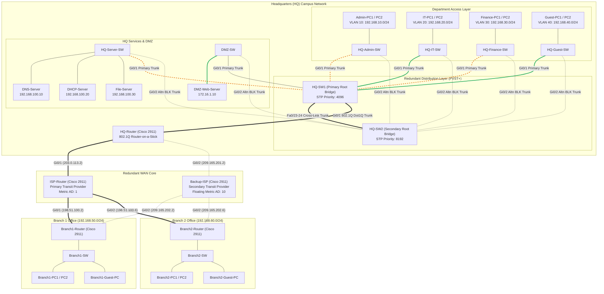

# 🛡️ Secure Multi-Branch Enterprise Network with Site-to-Site IPsec VPN, VLANs, ACLs & Redundant WAN Failover
## Computer Networks (CN) B.Tech Final Project & Demonstration

[](https://www.netacad.com/courses/packet-tracer)
[](#-site-to-site-ipsec-vpn-architecture)
[](#-redundant-wan-architecture--failover-mechanism)
[](#-site-to-site-ipsec-vpn-architecture)
[](#-security-implementation--access-control-lists)
[](#-lan-redundancy--spanning-tree-protocol-pvst)
[](#-empirical-verification--testing-results)
[](LICENSE)

---

## 📖 Project Introduction

In modern corporate environments, organizations operate across a central headquarters (HQ) and multiple remote branch locations. Corporate communications must traverse untrusted public Internet Service Provider (ISP) networks. This introduces critical security and availability challenges: unauthorized eavesdropping, data interception, single points of failure at the WAN edge, and internal broadcast flooding or unauthorized lateral movement between departments and guest users.

This project designs, implements, and empirically validates a complete, production-grade enterprise network simulation in **Cisco Packet Tracer 9.0 / 8.x**.

### Core Deliverables & Quick Links
- **Master Packet Tracer Topology:** [`Secure_MultiBranch_Enterprise_Network_Final.pkt`](Secure_MultiBranch_Enterprise_Network_Final.pkt)
- **Live Demonstration Guide:** [`docs/PROJECT_DEMONSTRATION_GUIDE.md`](docs/PROJECT_DEMONSTRATION_GUIDE.md) (Complete 7-stage script for professor demonstration)
- **Comprehensive Viva Guide:** [`docs/PROJECT_VIVA_GUIDE.md`](docs/PROJECT_VIVA_GUIDE.md) (Theory, architectural deep-dive & 25 Q&A)
- **Empirical Verification Evidence:** [`docs/VERIFICATION_EVIDENCE.md`](docs/VERIFICATION_EVIDENCE.md) (Full test logs & CLI proof)
- **Device Configurations:** [`configs/`](configs/) (Exported router and switch running configurations)

---

## 🌟 Main Features

1. **Departmental VLAN Segmentation (802.1Q):**
   - Independent broadcast domains for Administration (VLAN 10), IT (VLAN 20), Finance (VLAN 30), and Guest (VLAN 40).
   - Dedicated Server Farm (VLAN 100) and Demilitarized Zone (DMZ - VLAN 50).
2. **Router-on-a-Stick (ROAS) Inter-VLAN Routing:**
   - 802.1Q subinterfaces on `HQ-Router` (`Gi0/0.10` through `Gi0/0.100`) providing line-rate routing and security enforcement.
3. **Centralized DHCP Relay & DNS Infrastructure:**
   - Dynamic IP address leasing across all departmental VLANs via `ip helper-address 192.168.100.20`.
   - Authoritative DNS resolution for enterprise domains (`web.corp.local`, `enterprise.corp`, `fileserver.corp.local`).
4. **Isolated Demilitarized Zone (DMZ):**
   - Publicly accessible DMZ Web Server (`172.16.1.10`) reachable by corporate and guest users, while preventing DMZ hosts from initiating unprompted sessions into internal corporate VLANs.
5. **Site-to-Site IPsec VPN Tunnels:**
   - Confidential tunnels linking HQ to Branch 1 and Branch 2 over untrusted public WANs.
   - IKE Phase 1 ISAKMP (AES-128, Pre-shared Key `ciscoVPN2026`, SHA-1, DH Group 2) reaching `QM_IDLE ACTIVE`.
   - Phase 2 IPsec transform-set (`esp-aes esp-sha-hmac`) running in Tunnel Mode with mirrored crypto ACLs.
6. **Dual-WAN Redundancy & Automated Failover:**
   - Primary ISP (`ISP-Router`) and Backup ISP (`Backup-ISP`).
   - Primary default route (Administrative Distance 1) paired with Floating Static Routes (Administrative Distance 10).
   - Instant failover upon link state change and automatic pre-emption upon primary link recovery.
7. **Per-VLAN Spanning Tree Plus (PVST+):**
   - Deterministic Layer 2 loop prevention.
   - Primary Root Bridge on `HQ-SW1` (priority 4096) and Secondary Root Bridge on `HQ-SW2` (priority 8192).
   - Access switch uplinks configured with active Root Forwarding (`Root FWD`) and Alternate Blocking (`Altn BLK`).
8. **Granular Extended Access Control Lists (ACLs):**
   - Ingress filtering on gateways enforcing guest isolation across HQ, Branch 1, and Branch 2 with verified zero-leakage into VPN tunnels.

---

## 📸 Network Topology Overview

### Live Running Topology Canvas


### Logical Architecture Diagram


---

## 💻 Software & Devices Used

### Software
- **Simulation Platform:** Cisco Packet Tracer 9.0.1 (fully compatible with v8.2 and v8.0+)
- **Operating Systems Simulated:** Cisco IOS Software, C2900 Software (`C2900-UNIVERSALK9-M`, Version 15.1(4)M5) & Catalyst 2960 Software (`C2960-LANBASE-M`, Version 12.2(25)FX)

### Hardware Device Count (36 Devices Total)
- **Routers (5):**
  - 1x `HQ-Router` (Cisco 2911 ISR with Security Technology Package `securityk9`)
  - 2x Branch Routers (`Branch1-Router`, `Branch2-Router` - Cisco 2911 ISRs)
  - 2x ISP Routers (`ISP-Router`, `Backup-ISP` - Cisco 2911 ISRs)
- **Switches (10):**
  - 2x Distribution Switches (`HQ-SW1`, `HQ-SW2` - Cisco Catalyst 2960-24TT)
  - 6x HQ Access Switches (`HQ-Admin-SW`, `HQ-IT-SW`, `HQ-Finance-SW`, `HQ-Guest-SW`, `HQ-Server-SW`, `DMZ-SW`)
  - 2x Branch Access Switches (`Branch1-SW`, `Branch2-SW`)
- **Servers (4):**
  - `DNS-Server` (`192.168.100.10`)
  - `DHCP-Server` (`192.168.100.20`)
  - `File-Server` (`192.168.100.30`)
  - `DMZ-Web-Server` (`172.16.1.10`)
- **Workstations (14 PCs):**
  - HQ Department PCs (`Admin-PC1`, `Admin-PC2`, `IT-PC1`, `IT-PC2`, `Finance-PC1`, `Finance-PC2`, `Guest-PC1`, `Guest-PC2`)
  - Branch 1 PCs (`Branch1-PC1`, `Branch1-PC2`, `Branch1-Guest-PC`)
  - Branch 2 PCs (`Branch2-PC1`, `Branch2-PC2`, `Branch2-Guest-PC`)
- **Power Distribution Units (3):** Rack PDUs providing power management

---

## 📊 Complete IP Addressing & VLAN Scheme

### HQ Campus Subnets & VLANs

| Department / Function | VLAN ID | IP Subnet | Subinterface / Gateway | Subnet Mask | Usable Host Range | DHCP Pool Name |
| :--- | :---: | :--- | :--- | :--- | :--- | :--- |
| **Administration** | 10 | `192.168.10.0/24` | `Gi0/0.10` (`192.168.10.1`) | `255.255.255.0` | `.11` – `.254` | `ADMIN_POOL` |
| **Information Technology (IT)** | 20 | `192.168.20.0/24` | `Gi0/0.20` (`192.168.20.1`) | `255.255.255.0` | `.11` – `.254` | `IT_POOL` |
| **Finance** | 30 | `192.168.30.0/24` | `Gi0/0.30` (`192.168.30.1`) | `255.255.255.0` | `.11` – `.254` | `FINANCE_POOL` |
| **Guest Wireless / LAN** | 40 | `192.168.40.0/24` | `Gi0/0.40` (`192.168.40.1`) | `255.255.255.0` | `.11` – `.254` | `GUEST_POOL` |
| **DMZ Network** | 50 | `172.16.1.0/24` | `Gi0/0.50` (`172.16.1.1`) | `255.255.255.0` | `.10` – `.254` | Static |
| **Corporate Server Farm** | 100 | `192.168.100.0/24` | `Gi0/0.100` (`192.168.100.1`) | `255.255.255.0` | `.10` – `.254` | Static / Exclusion |

### Branch Office Subnets

| Branch Name | VLAN ID | IP Subnet | Router Gateway | Subnet Mask | Usable Host Range | DHCP Pool Name |
| :--- | :---: | :--- | :--- | :--- | :--- | :--- |
| **Branch 1 (North)** | 1 (Access) | `192.168.50.0/24` | `Gi0/0` (`192.168.50.1`) | `255.255.255.0` | `.11` – `.254` | `BRANCH1_ROUTER_POOL` |
| **Branch 2 (South)** | 1 (Access) | `192.168.60.0/24` | `Gi0/0` (`192.168.60.1`) | `255.255.255.0` | `.11` – `.254` | `BRANCH2_LAN` |

### WAN Point-to-Point Transit Links

| Link Purpose | Provider | Subnet | Side A Interface & IP | Side B Interface & IP | Primary / Backup |
| :--- | :--- | :--- | :--- | :--- | :---: |
| **HQ Primary WAN** | `ISP-Router` | `203.0.113.0/30` | `HQ-Router` `Gi0/1` (`203.0.113.2`) | `ISP-Router` `Gi0/0` (`203.0.113.1`) | Primary (AD 1) |
| **Branch 1 Primary WAN** | `ISP-Router` | `198.51.100.0/30` | `Branch1-Router` `Gi0/1` (`198.51.100.2`) | `ISP-Router` `Gi0/1` (`198.51.100.1`) | Primary (AD 1) |
| **Branch 2 Primary WAN** | `ISP-Router` | `198.51.100.4/30` | `Branch2-Router` `Gi0/1` (`198.51.100.6`) | `ISP-Router` `Gi0/2` (`198.51.100.5`) | Primary (AD 1) |
| **HQ Backup WAN** | `Backup-ISP` | `209.165.201.0/30` | `HQ-Router` `Gi0/2` (`209.165.201.2`) | `Backup-ISP` `Gi0/0` (`209.165.201.1`) | Backup (AD 10) |
| **Branch 1 Backup WAN** | `Backup-ISP` | `209.165.202.0/30` | `Branch1-Router` `Gi0/2` (`209.165.202.2`) | `Backup-ISP` `Gi0/1` (`209.165.202.1`) | Backup (AD 10) |
| **Branch 2 Backup WAN** | `Backup-ISP` | `209.165.202.4/30` | `Branch2-Router` `Gi0/2` (`209.165.202.6`) | `Backup-ISP` `Gi0/2` (`209.165.202.5`) | Backup (AD 10) |

---

## 🚀 How to Open & Run the Packet Tracer Project

1. Install **Cisco Packet Tracer 8.0+** or **9.0+**.
2. Clone or download this repository:
   ```bash
   git clone https://github.com/zerotrace7/Internet-Cafe-Network-Design.git
   cd Internet-Cafe-Network-Design
   ```
3. Launch Packet Tracer and open the file:
   ```
   Secure_MultiBranch_Enterprise_Network_Final.pkt
   ```
4. Allow the simulation clock to run for **30 seconds**.
   - *Why?* Spanning Tree Protocol (PVST+) transitions interfaces through Listening and Learning states before reaching Forwarding. Link LEDs will turn solid green (forwarding) or amber (blocked redundant ports).

---

## 🎬 How to Reproduce Major Demonstrations

Detailed step-by-step instructions for all 7 stages are provided in [`docs/PROJECT_DEMONSTRATION_GUIDE.md`](docs/PROJECT_DEMONSTRATION_GUIDE.md). Below is the quick summary:

### 1. Departmental DHCP & Inter-VLAN Routing
- Open `Admin-PC1` → **Desktop** → **Command Prompt**:
  ```cmd
  ipconfig /renew
  ping 192.168.20.11
  nslookup web.corp.local
  ```
- *Result:* Receives IP `192.168.10.11`, Gateway `192.168.10.1`, DNS `192.168.100.10`; 0% ping loss; domain resolves to `172.16.1.10`.

### 2. DMZ Web Server Access
- Open `Admin-PC1` or `Guest-PC1` → **Desktop** → **Web Browser**.
- Navigate to: `http://web.corp.local` or `http://172.16.1.10`.
- *Result:* Enterprise web page loads immediately.

### 3. IPsec Encrypted Inter-Branch Communication
- From `Admin-PC1`, ping remote branch PC:
  ```cmd
  ping 192.168.50.11
  ```
- Open `HQ-Router` CLI:
  ```cisco
  show crypto isakmp sa
  show crypto ipsec sa
  ```
- *Result:* `QM_IDLE ACTIVE` status for both branch tunnels; `#pkts encrypt` and `#pkts decrypt` counters increment.

### 4. Zero-Trust Guest Isolation
- Open `Guest-PC1` (`192.168.40.11`) and attempt to ping corporate PC:
  ```cmd
  ping 192.168.10.11
  ```
- *Result:* Dropped with `Reply from 192.168.40.1: Destination host unreachable`.
- Open `HQ-Router` CLI: `show access-lists 140` verifies drop counters.

### 5. Automated Dual-WAN Failover & Recovery
- Open `HQ-Router` CLI and shut down the primary WAN link:
  ```cisco
  configure terminal
  interface GigabitEthernet0/1
  shutdown
  end
  show ip route static
  ```
- *Result:* Default route instantly switches from Primary ISP (`203.0.113.1` AD 1) to Backup ISP (`209.165.201.1` AD 10).
- Ping from `Admin-PC1` to `Branch1-PC1` passes seamlessly over `VPN-BACKUP`.
- Restore primary WAN: `interface GigabitEthernet0/1` → `no shutdown`.
- *Result:* Primary route (AD 1) immediately pre-empts the floating route.

### 6. Layer 2 Spanning Tree Loop Prevention
- Open `HQ-SW1` CLI: `show spanning-tree vlan 10` → Shows `This bridge is the root` (priority 4096).
- Open `HQ-Admin-SW` CLI: `show spanning-tree vlan 10` → Shows `Gi0/1` in `Root FWD` and `Gi0/2` in `Altn BLK`.

---

## ⚠️ Project Limitations & Production Trade-Offs

While this project satisfies and exceeds academic enterprise networking criteria, the following known limitations and production enhancements should be noted:

1. **Static Crypto Maps vs. DMVPN:** The project utilizes static site-to-site IPsec crypto maps. In real-world enterprises with dozens of branches, Dynamic Multipoint VPN (DMVPN) with mGRE and NHRP is preferred to avoid full-mesh configuration scaling issues.
2. **Link-State Failover vs. IP SLA Tracking:** The failover mechanism relies on interface link-state detection (`line protocol down`). In carrier networks where an upstream ISP router fails without dropping the local physical link, Cisco IP SLA with Object Tracking would be necessary.
3. **PVST+ Convergence Timing:** Classical 802.1D PVST+ requires 30–50 seconds to transition through Listening/Learning states during topology changes. Modern networks utilize Rapid PVST+ (802.1w) for sub-second convergence.
4. **Pre-Shared Key (PSK) Authentication:** While convenient and secure for small topologies, enterprise environments utilize Public Key Infrastructure (PKI) with X.509 digital certificates.
5. **IOS Router ACLs vs. NGFW:** Access filtering is performed via Cisco IOS router access lists. Real-world perimeters deploy dedicated Next-Generation Firewalls (NGFW) with stateful Layer 7 Deep Packet Inspection.

---

## 📂 Repository Directory Structure

```
.
├── Secure_MultiBranch_Enterprise_Network_Final.pkt # Clean, fully verified final Cisco Packet Tracer project
├── Secure_MultiBranch_IPsec_VPN.pkt          # Primary working Cisco Packet Tracer project
├── Secure_MultiBranch_IPsec_VPN_backup_before_cleanup.pkt # Original safety backup
├── Secure_MultiBranch_Enterprise_Network_Final_prefinal_backup.pkt # Pre-final verification backup
├── README.md                                 # Master documentation
├── AGENTS.md                                 # MCP agent guidelines
├── configs/                                  # Exported router and switch running configurations
│   ├── HQ-Router.cfg                         # HQ Gateway configuration
│   ├── Branch1-Router.cfg                    # Branch 1 Gateway configuration
│   ├── Branch2-Router.cfg                    # Branch 2 Gateway configuration
│   ├── ISP-Router-VPN.cfg                    # Primary ISP configuration
│   ├── Backup-ISP-Router.cfg                 # Secondary ISP configuration
│   ├── HQ-SW1.cfg                            # Primary Distribution Switch (Root Bridge)
│   ├── HQ-SW2.cfg                            # Secondary Distribution Switch
│   ├── HQ-Admin-SW.cfg                       # Administration Access Switch
│   ├── HQ-IT-SW.cfg                          # IT Department Access Switch
│   ├── HQ-Finance-SW.cfg                     # Finance Department Access Switch
│   ├── HQ-Guest-SW.cfg                       # Guest Access Switch
│   ├── HQ-Server-SW.cfg                      # Server Farm Access Switch
│   ├── DMZ-SW.cfg                            # DMZ Access Switch
│   ├── Branch1-SW.cfg                        # Branch 1 Access Switch
│   └── Branch2-SW.cfg                        # Branch 2 Access Switch
└── docs/                                     # Demonstration guides, viva questions, and evidence
    ├── PROJECT_DEMONSTRATION_GUIDE.md        # Step-by-step live demonstration script (Stages 1–7)
    ├── PROJECT_VIVA_GUIDE.md                 # Complete viva revision guide & 25 Q&A
    ├── VERIFICATION_EVIDENCE.md              # Empirical test logs (Tests 1–12)
    ├── final_topology.png                    # Final organized topology screenshot
    └── live_running_topology.png             # Canvas capture of active Packet Tracer project
```

---

## 👨‍🎓 Author & Academic Attribution
- **Project Title:** Secure Multi-Branch Enterprise Network Using Site-to-Site IPsec VPN, ACLs, VLANs, and Redundant WAN Failover
- **Course:** Computer Networks (B.Tech Computer Science & Engineering)
- **Simulation Platform:** Cisco Packet Tracer 9.0.1
