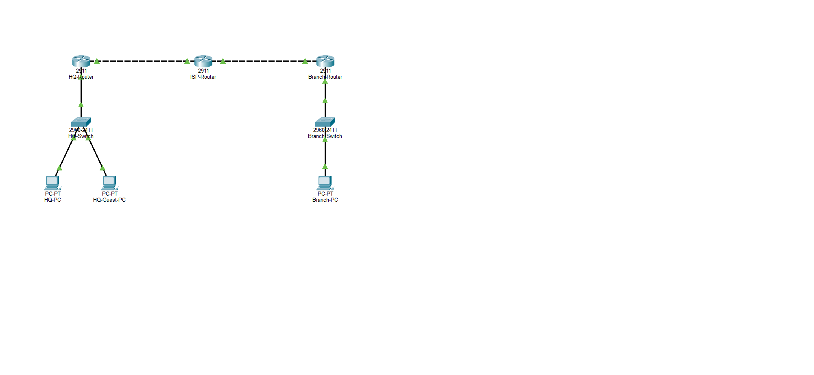

# 🛡️ Secure Multi-Branch Enterprise Network with Site-to-Site IPsec VPN
## Computer Networks (CN) B.Tech Project — Major Review (Part 1)

[](https://www.netacad.com/courses/packet-tracer)
[](#site-to-site-ipsec-vpn-architecture)
[](#site-to-site-ipsec-vpn-architecture)
[](#access-control-lists-acl)
[](#verification--test-results)
[](LICENSE)

A production-grade, empirically verified implementation of a **Secure Multi-Branch Enterprise Network** using **Site-to-Site IPsec VPN** and **Extended Access Control Lists (ACLs)**, designed and simulated in **Cisco Packet Tracer**.

---

## 📌 Project Objectives (Major Review)

- **Geographic Inter-Branch Connectivity**: Connect an Enterprise Headquarter (HQ) and a Remote Branch office across a simulated public ISP transit network (`203.0.113.0/30` and `198.51.100.0/30`).
- **Data Confidentiality & Integrity**: Establish a hardware-accelerated Site-to-Site IPsec VPN tunnel between edge routers (`HQ-Router` and `Branch-Router`), encrypting all inter-office traffic with AES and authenticating via SHA-1 HMAC.
- **Role-Based Access Control**: Enforce edge-level Extended Access Control Lists (ACLs) to permit authorized workstations while explicitly denying unauthorized guest terminals.
- **Strict Scope Adherence**: Standard switch-based broadcast domains **without VLANs, 802.1Q trunks, or inter-VLAN routing**, strictly reserved for the Major Review boundary.
- **Empirical Proof**: Full IOS control-plane (`QM_IDLE`) and data-plane (`#pkts encaps` / `#pkts decaps`) verification in Packet Tracer.

---

## 📸 Network Topology Overview

```mermaid
graph LR
    subgraph HQ_LAN ["HQ Office LAN (192.168.10.0/24)"]
        HQ_PC["HQ-PC<br/>192.168.10.10<br/>(Authorized)"] ---|Fa0 <--> Fa0/1| HQ_SW["HQ-Switch<br/>(Cisco 2960)"]
        HQ_GUEST["HQ-Guest-PC<br/>192.168.10.50<br/>(Unauthorized)"] ---|Fa0 <--> Fa0/2| HQ_SW
        HQ_SW ---|Gi0/1 <--> Gi0/0| HQ_R["HQ-Router<br/>(Cisco 2911)<br/>GW: 192.168.10.1"]
    end

    subgraph WAN_CORE ["Simulated Public ISP Transit"]
        ISP_R["ISP-Router<br/>(Cisco 2911 Transit)"]
        HQ_R ---|"Gi0/1 <--> Gi0/0<br/>203.0.113.0/30 (Cross Cable)"| ISP_R
        ISP_R ---|"Gi0/1 <--> Gi0/1<br/>198.51.100.0/30 (Cross Cable)"| BR_R["Branch-Router<br/>(Cisco 2911)<br/>GW: 192.168.20.1"]
    end

    subgraph BRANCH_LAN ["Branch Office LAN (192.168.20.0/24)"]
        BR_R ---|Gi0/0 <--> Gi0/1| BR_SW["Branch-Switch<br/>(Cisco 2960)"]
        BR_SW ---|Fa0/1 <--> Fa0| BR_PC["Branch-PC<br/>192.168.20.10<br/>(Branch Host)"]
    end

    linkStyle 3 stroke:#2ecc71,stroke-width:3px;
    linkStyle 4 stroke:#2ecc71,stroke-width:3px;

    classDef router fill:#3498db,stroke:#1d6fa5,stroke-width:2px,color:#fff;
    classDef switch fill:#9b59b6,stroke:#6c3483,stroke-width:2px,color:#fff;
    classDef pc fill:#1abc9c,stroke:#117864,stroke-width:2px,color:#fff;

    class HQ_R,ISP_R,BR_R router;
    class HQ_SW,BR_SW switch;
    class HQ_PC,HQ_GUEST,BR_PC pc;
```





---

## 📊 IP Addressing & Interface Plan

| Device Name | Interface | IP Address | Subnet Mask | Default Gateway | Function / Role |
| :--- | :--- | :--- | :--- | :--- | :--- |
| **`HQ-Router`** | `Gi0/0` | `192.168.10.1` | `255.255.255.0` (/24) | N/A | HQ Internal LAN Gateway |
| **`HQ-Router`** | `Gi0/1` | `203.0.113.2` | `255.255.255.252` (/30) | `203.0.113.1` | HQ Public WAN Interface (Crypto Map) |
| **`HQ-PC`** | `FastEthernet0` | `192.168.10.10` | `255.255.255.0` (/24) | `192.168.10.1` | Authorized HQ Test Endpoint |
| **`HQ-Guest-PC`** | `FastEthernet0` | `192.168.10.50` | `255.255.255.0` (/24) | `192.168.10.1` | Unauthorized Guest Terminal (ACL Denied) |
| **`ISP-Router`** | `Gi0/0` | `203.0.113.1` | `255.255.255.252` (/30) | N/A | ISP Gateway towards HQ |
| **`ISP-Router`** | `Gi0/1` | `198.51.100.1` | `255.255.255.252` (/30) | N/A | ISP Gateway towards Branch |
| **`Branch-Router`**| `Gi0/1` | `198.51.100.2` | `255.255.255.252` (/30) | `198.51.100.1` | Branch Public WAN Interface (Crypto Map) |
| **`Branch-Router`**| `Gi0/0` | `192.168.20.1` | `255.255.255.0` (/24) | N/A | Branch Internal LAN Gateway |
| **`Branch-PC`** | `FastEthernet0` | `192.168.20.10` | `255.255.255.0` (/24) | `192.168.20.1` | Branch Test Endpoint |

---

## 🔒 Site-to-Site IPsec VPN Architecture

### Phase 1: IKE / ISAKMP Policy
- **Encryption:** AES-128 (`encryption aes`)
- **Hash:** SHA-1 (`hash sha`)
- **Authentication:** Pre-Shared Key (`ciscoVPN2026`)
- **Diffie-Hellman Group:** Group 2 (1024-bit modulus)
- **Lifetime:** 86,400 seconds (24 hours)

### Phase 2: IPsec Transform Set & Crypto Map
- **Transform Set:** `VPN-TS` (`esp-aes esp-sha-hmac` in `Tunnel` mode)
- **Interesting Traffic ACL:**
  - `HQ-Router`: `access-list 101 permit ip 192.168.10.0 0.0.0.255 192.168.20.0 0.0.0.255`
  - `Branch-Router`: `access-list 101 permit ip 192.168.20.0 0.0.0.255 192.168.10.0 0.0.0.255`
- **Crypto Map:** `VPN-MAP` applied directly to `GigabitEthernet0/1` on both edge routers.

---

## 🛡️ Access Control Lists (ACL)

To enforce security boundaries, `HQ-Router` filters ingress traffic on `GigabitEthernet0/0`:
```cisco
access-list 110 deny ip host 192.168.10.50 192.168.20.0 0.0.0.255
access-list 110 permit ip 192.168.10.0 0.0.0.255 192.168.20.0 0.0.0.255
access-list 110 permit ip any any
```
- **Permitted Flow:** `HQ-PC` (`192.168.10.10`) pings `Branch-PC` (`192.168.20.10`) -> **PASSED & ENCRYPTED**.
- **Denied Flow:** `HQ-Guest-PC` (`192.168.10.50`) pings `Branch-PC` (`192.168.20.10`) -> **DROPPED AT GATEWAY** (`Destination host unreachable`).

---

## 🧪 Verification & Empirical Test Results

All tests have been executed directly inside the Cisco Packet Tracer simulation engine:

| Test ID | Test Case | Target / Action | Expected Result | Actual Result Observed | Status |
|:---:|:---|:---|:---|:---|:---:|
| **Test A** | Pre-VPN Baseline Routing | `HQ-PC` ping `Branch-PC` | Plain IP reachability | 4/4 replies received (0% loss) | ✅ PASS |
| **Test B** | ISAKMP Phase 1 SA | `show crypto isakmp sa` | State: `QM_IDLE ACTIVE` | `203.0.113.2 <-> 198.51.100.2 QM_IDLE ACTIVE` | ✅ PASS |
| **Test C** | IPsec Encapsulation Counters | `show crypto ipsec sa` | `#pkts encaps` & `decaps` increment | Symmetrical counters: `#pkts encaps: 7`, `#pkts decaps: 7` | ✅ PASS |
| **Test D1**| Access Control (Permitted) | `HQ-PC` ping `Branch-PC` | 4/4 replies; ACL match | 4/4 replies; ACL 110 rule 20 incremented | ✅ PASS |
| **Test D2**| Access Control (Denied) | `HQ-Guest-PC` ping `Branch-PC` | Destination host unreachable | 0/4 replies (100% loss); ACL 110 rule 10 = 4 matches | ✅ PASS |
| **Test E** | Tunnel Stability (Reverse) | `Branch-PC` ping `HQ-PC` | Bi-directional IPsec | 4/4 replies; Branch encaps = 11, HQ decaps = 11 | ✅ PASS |

Full terminal logs, command outputs, and SPI verification are documented in [`docs/VERIFICATION_EVIDENCE.md`](docs/VERIFICATION_EVIDENCE.md).

---

## 🗂️ Project Repository Structure

```tree
Internet-Cafe-Network-Design/
├── Secure_MultiBranch_IPsec_VPN.pkt          # Primary verified Packet Tracer simulation (Major Review)
├── Internet-Cafe-Network-Design.pkt          # Historical reference simulation
├── configs/                                  # Standalone Cisco IOS startup configurations
│   ├── HQ-Router.cfg                         # HQ Gateway with IPsec & ACL 110
│   ├── Branch-Router.cfg                     # Branch Gateway with IPsec
│   ├── ISP-Router-VPN.cfg                    # Simulated ISP Transit Gateway
│   ├── HQ-Switch.cfg                         # HQ Access Switch
│   └── Branch-Switch.cfg                     # Branch Access Switch
├── docs/                                     # Documentation and test records
│   ├── MAJOR_REVIEW_GUIDE.md                 # Complete implementation guide & viva preparation
│   ├── VERIFICATION_EVIDENCE.md              # Empirical test logs, counters, and outputs
│   └── secure_vpn_topology.png               # Cisco Packet Tracer canvas screenshot
├── LICENSE                                   # MIT License
└── README.md                                 # Project documentation
```

---

## 🚀 How to Run & Verify the Simulation

1. Install **Cisco Packet Tracer** (version 8.0 or newer).
2. Clone this repository:
   ```bash
   git clone https://github.com/ZeroTrace7/Internet-Cafe-Network-Design.git
   cd Internet-Cafe-Network-Design
   ```
3. Open [`Secure_MultiBranch_IPsec_VPN.pkt`](Secure_MultiBranch_IPsec_VPN.pkt) in Cisco Packet Tracer.
4. Verify all link LEDs are green.
5. Open `HQ-PC` -> **Desktop** -> **Command Prompt**:
   ```cmd
   ping 192.168.20.10
   ```
6. Open `HQ-Router` -> **CLI** -> Enter enable mode:
   ```cisco
   show crypto isakmp sa
   show crypto ipsec sa
   show access-lists
   ```
7. Open `HQ-Guest-PC` -> **Command Prompt**:
   ```cmd
   ping 192.168.20.10
   ```
   Confirm that packets are dropped with `Destination host unreachable`.

---

## 📚 Examination & Viva Reference

For detailed theoretical explanations, architectural diagrams, step-by-step assembly guides, and answers to common examiner viva questions, refer to:
👉 **[`docs/MAJOR_REVIEW_GUIDE.md`](docs/MAJOR_REVIEW_GUIDE.md)**

---

## 👤 Author

- **ZeroTrace7** — [GitHub Profile](https://github.com/ZeroTrace7)
- **Course:** B.Tech Computer Networks (Major Review)
