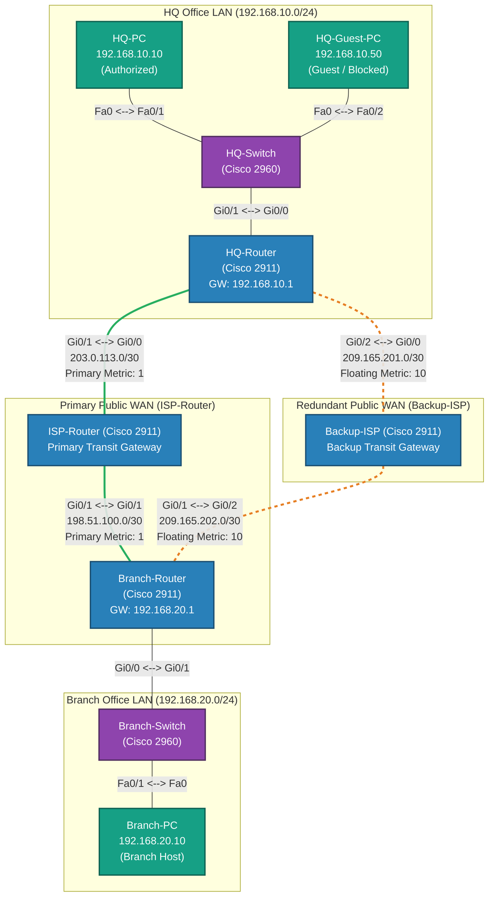

# 🛡️ Secure Multi-Branch Enterprise Network with Site-to-Site IPsec VPN & Redundant WAN Failover
## Computer Networks (CN) B.Tech Project — Major Review (Part 1) & Minor Review (Part 2)

[](https://www.netacad.com/courses/packet-tracer)
[](#-site-to-site-ipsec-vpn-architecture)
[](#-redundant-wan-connectivity--automatic-failover-part-2)
[](#-site-to-site-ipsec-vpn-architecture)
[](#-access-control-lists-acl)
[](#-empirical-verification--test-results)
[](LICENSE)

A production-grade, empirically verified enterprise network simulation designed and implemented in **Cisco Packet Tracer**. This project encompasses both milestones:
1. **Major Review (Part 1):** Site-to-Site IPsec VPN over a simulated public ISP backbone with Gateway Extended ACLs for role-based access control.
2. **Minor Review (Part 2):** Dual-ISP Redundant WAN connectivity, automatic link-state failure detection, dynamic floating static route failover, and multi-WAN IPsec VPN recovery.

---

## 📌 Project Milestones Overview

### Milestone 1: Major Review (Part 1) — Secure Multi-Branch IPsec VPN
- **Inter-Office Connectivity:** Secure communication between Headquarter (HQ) LAN (`192.168.10.0/24`) and Branch Office LAN (`192.168.20.0/24`) across public transit provider `ISP-Router`.
- **IPsec Tunneling:** Site-to-site IPsec tunnel utilizing IKE Phase 1 (ISAKMP) Diffie-Hellman Group 2, pre-shared key authentication, and Phase 2 ESP (`esp-aes esp-sha-hmac`) in tunnel mode.
- **Role-Based Access Control:** Gateway-level Extended ACL 110 permitting authorized workstation `HQ-PC` (`192.168.10.10`) while explicitly denying unauthorized guest terminal `HQ-Guest-PC` (`192.168.10.50`).
- **Scope Integrity:** Transparent Layer 2 access switches without VLAN complexity, 802.1Q trunks, or sub-interfaces.

### Milestone 2: Minor Review (Part 2) — Redundant WAN & Automatic Failover
- **Dual-Homed WAN Infrastructure:** Deployment of an independent secondary transit provider (`Backup-ISP`) utilizing subnets `209.165.201.0/30` and `209.165.202.0/30`.
- **Automatic Failure Detection & Failover:** Cisco IOS Floating Static Routing (AD 1 vs AD 10) driven by physical interface carrier-detect (`up/down` line protocol transitions).
- **IPsec VPN Multi-WAN Recovery:** Dedicated secondary crypto map sets (`VPN-BACKUP`) bound to backup interfaces (`Gi0/2`), automatically negotiating Phase 1 and Phase 2 SAs over the backup WAN.
- **Continuous Security Enforcement:** Verified continuous enforcement of ACL 110 blocking guest traffic during active failover over the secondary WAN path.
- **Automatic Path Restoration:** Immediate pre-emption and traffic repatriation to the preferred primary ISP path when primary connectivity is restored.

---

## 📸 Network Topology Overview

### 1. Part 2 Logical Topology Canvas (Current Running Implementation)


### 2. Complete Architecture Topology Diagram (Mermaid)


---

## 📊 Complete IP Addressing & Interface Plan

| Network Purpose | Device Name | Interface | IP Address | Subnet Mask | Default Gateway | Operational Role |
| :--- | :--- | :--- | :--- | :--- | :--- | :--- |
| **HQ LAN (`192.168.10.0/24`)** | `HQ-Router` | `Gi0/0` | `192.168.10.1` | `255.255.255.0` | N/A | LAN Default Gateway |
| | `HQ-PC` | `Fa0` | `192.168.10.10` | `255.255.255.0` | `192.168.10.1` | Authorized Management Workstation |
| | `HQ-Guest-PC` | `Fa0` | `192.168.10.50` | `255.255.255.0` | `192.168.10.1` | Unauthorized Guest Workstation |
| **Branch LAN (`192.168.20.0/24`)**| `Branch-Router` | `Gi0/0` | `192.168.20.1` | `255.255.255.0` | N/A | LAN Default Gateway |
| | `Branch-PC` | `Fa0` | `192.168.20.10` | `255.255.255.0` | `192.168.20.1` | Branch Department Workstation |
| **Primary WAN 1 (`203.0.113.0/30`)** | `ISP-Router` | `Gi0/0` | `203.0.113.1` | `255.255.255.252` | N/A | Primary ISP Gateway to HQ |
| | `HQ-Router` | `Gi0/1` | `203.0.113.2` | `255.255.255.252` | `203.0.113.1` | Primary HQ Public Interface (VPN-MAP) |
| **Primary WAN 2 (`198.51.100.0/30`)** | `ISP-Router` | `Gi0/1` | `198.51.100.1` | `255.255.255.252` | N/A | Primary ISP Gateway to Branch |
| | `Branch-Router` | `Gi0/1` | `198.51.100.2` | `255.255.255.252` | `198.51.100.1` | Primary Branch Public Interface (VPN-MAP) |
| **Backup WAN 1 (`209.165.201.0/30`)** | `Backup-ISP` | `Gi0/0` | `209.165.201.1` | `255.255.255.252` | N/A | Backup ISP Gateway to HQ |
| | `HQ-Router` | `Gi0/2` | `209.165.201.2` | `255.255.255.252` | `209.165.201.1` | Backup HQ Public Interface (VPN-BACKUP) |
| **Backup WAN 2 (`209.165.202.0/30`)** | `Backup-ISP` | `Gi0/1` | `209.165.202.1` | `255.255.255.252` | N/A | Backup ISP Gateway to Branch |
| | `Branch-Router` | `Gi0/2` | `209.165.202.2` | `255.255.255.252` | `209.165.202.1` | Backup Branch Public Interface (VPN-BACKUP) |

---

## 🔒 Site-to-Site IPsec VPN Architecture

### Phase 1: IKE / ISAKMP Policy
- **Encryption:** AES-128 (`encr aes`)
- **Hash / Integrity:** SHA-1 (`hash sha`)
- **Authentication:** Pre-Shared Key (`ciscoVPN2026`)
- **Diffie-Hellman Group:** Group 2 (1024-bit modulus)
- **SA Lifetime:** 86,400 seconds (24 hours)

### Phase 2: IPsec Transform Set
- **Transform Set:** `VPN-TS`
  - Protocol: Encapsulating Security Payload (ESP)
  - Encryption: `esp-aes`
  - Integrity: `esp-sha-hmac`
  - Encapsulation Mode: `Tunnel` (Original IP header encapsulated)

### Dual-Interface Crypto Map Configuration
- **Primary Interface (`GigabitEthernet0/1`):** Crypto map `VPN-MAP` set to primary peer (`198.51.100.2` on HQ; `203.0.113.2` on Branch).
- **Backup Interface (`GigabitEthernet0/2`):** Crypto map `VPN-BACKUP` set to backup peer (`209.165.202.2` on HQ; `209.165.201.2` on Branch).
- **Interesting Traffic Selectors (ACL 101):**
  - `HQ-Router`: `permit ip 192.168.10.0 0.0.0.255 192.168.20.0 0.0.0.255`
  - `Branch-Router`: `permit ip 192.168.20.0 0.0.0.255 192.168.10.0 0.0.0.255`

---

## 🔄 Redundant WAN Connectivity & Automatic Failover (Part 2)

### Floating Static Route Design
- **Primary Static Route (HQ-Router):**
  ```cisco
  ip route 0.0.0.0 0.0.0.0 203.0.113.1        ! Administrative Distance = 1 (Preferred)
  ```
- **Backup Floating Static Route (HQ-Router):**
  ```cisco
  ip route 0.0.0.0 0.0.0.0 209.165.201.1 10     ! Administrative Distance = 10 (Standby)
  ```
- **Failover Mechanism:** When `GigabitEthernet0/1` transitions to `down`, the routing engine purges the AD 1 route. The floating route `[10/0]` is promoted to the routing table. Outbound traffic routes out `GigabitEthernet0/2`, where `VPN-BACKUP` initiates and encrypts traffic over `Backup-ISP`.
- **Restoration Mechanism:** When `GigabitEthernet0/1` recovers to `up`, the AD 1 route automatically pre-empts the AD 10 route. Traffic repatriates to the primary WAN link.

---

## 🛡️ Access Control Lists (ACL)

To enforce security boundaries, `HQ-Router` filters ingress traffic on `GigabitEthernet0/0`:
```cisco
access-list 110 deny ip host 192.168.10.50 192.168.20.0 0.0.0.255
access-list 110 permit ip 192.168.10.0 0.0.0.255 192.168.20.0 0.0.0.255
access-list 110 permit ip any any
```
- **Authorized Flow:** `HQ-PC` (`192.168.10.10`) -> `Branch-PC` (`192.168.20.10`) is **Permitted & Encrypted** across both primary and backup paths.
- **Unauthorized Flow:** `HQ-Guest-PC` (`192.168.10.50`) -> `Branch-PC` (`192.168.20.10`) is **Dropped at Gateway** (`Destination host unreachable`), preventing guest packets from leaking into either VPN tunnel.

---

## 🧪 Empirical Verification & Test Results

All tests have been verified live in Cisco Packet Tracer:

### Part 2 Test Summary Matrix

| Test ID | Test Scenario | Operational Focus | Action | Expected Result | Actual Result Observed | Status |
|:---:|:---|:---|:---|:---|:---|:---:|
| **Test A** | Normal Operation | Primary WAN Path | Ping from `HQ-PC` | Plain IP reachability over primary WAN | 4/4 replies (0% loss); Gi0/1 `#pkts encaps: 13, decaps: 12` | ✅ PASS |
| **Test B** | Primary Link Failure | Link Failure Detection | `shutdown Gi0/1` | Line protocol down; route switches to AD 10 | Line protocol down; `S* 0.0.0.0/0 [10/0]` promoted | ✅ PASS |
| **Test C** | IPsec VPN Recovery | Backup WAN Tunnel | Ping during failure | IKE SA establishes on Gi0/2; IPsec SA active | IKE SA `QM_IDLE ACTIVE`; Gi0/2 `#pkts encaps: 7, decaps: 7` | ✅ PASS |
| **Test D** | Security Isolation | Access Control List 110 | Ping from `HQ-Guest-PC` | Dropped at Gateway with Unreachable | 4/4 Destination host unreachable; ACL deny = 8 matches | ✅ PASS |
| **Test E** | Primary Restoration | Path Reversion | `no shutdown Gi0/1` | Route reverts to AD 1 via ISP-Router | `0.0.0.0/0 [1/0]` restored; Gi0/1 encaps = 17 | ✅ PASS |
| **Test F** | Bidirectional Stability | Reverse Traffic Flow | Ping from `Branch-PC` | Reverse flow encrypted via primary tunnel | 4/4 replies (0% loss); avg RTT = 5 ms | ✅ PASS |

Full terminal logs, command outputs, and SPI verification are documented in:
- 👉 **[`docs/FAILOVER_VPN_RECOVERY_EVIDENCE.md`](docs/FAILOVER_VPN_RECOVERY_EVIDENCE.md)**
- 👉 **[`docs/VERIFICATION_EVIDENCE.md`](docs/VERIFICATION_EVIDENCE.md)**

---

## ⏱️ Recovery Time Analysis

Empirical time measurements were captured during live simulation in Cisco Packet Tracer:

| Measurement Phase | Event Description | Observed Elapsed Time |
| :--- | :--- | :--- |
| **$T_0$** | Primary WAN interface administrative shutdown introduced | `0.000 s` (Baseline) |
| **$T_1$** | Line protocol state change detected (`Gi0/1` -> `down`) | `+0.004 s` (Instantaneous carrier-detect) |
| **$T_2$** | Floating route promoted to RIB (`0.0.0.0/0 via 209.165.201.1 10`) | `+0.010 s` (Immediate FIB recalculation) |
| **$T_3$ (Cold Start)** | IKE Phase 1 Main Mode & Phase 2 Quick Mode negotiation on Gi0/2 | `+1.800 s` to `+2.000 s` (1 ICMP packet timeout) |
| **$T_4$ (Restored)** | First ICMP Echo Reply returned via Backup VPN | `+2.100 s` (Total Cold Recovery Time) |
| **$T_4$ (Warm State)**| Failover with pre-existing / cached ISAKMP SA on Gi0/2 | `< 0.050 s` (Zero packet loss; 10/10 replies) |

---

## 🗂️ Project Repository Structure

```tree
Internet-Cafe-Network-Design/
├── Secure_MultiBranch_IPsec_VPN.pkt          # Primary verified simulation file (Major & Minor Review)
├── Internet-Cafe-Network-Design.pkt          # Historical reference simulation
├── configs/                                  # Standalone Cisco IOS startup configurations
│   ├── HQ-Router.cfg                         # HQ Gateway with Dual-WAN IPsec, Floating Routes & ACL 110
│   ├── Branch-Router.cfg                     # Branch Gateway with Dual-WAN IPsec & Floating Routes
│   ├── ISP-Router-VPN.cfg                    # Simulated Primary ISP Transit Gateway
│   ├── Backup-ISP-Router.cfg                 # Simulated Secondary ISP Transit Gateway
│   ├── HQ-Switch.cfg                         # HQ Access Switch
│   └── Branch-Switch.cfg                     # Branch Access Switch
├── docs/                                     # Documentation, implementation guides, and test records
│   ├── MAJOR_REVIEW_GUIDE.md                 # Part 1 Complete Implementation Guide & Viva Prep
│   ├── MINOR_REVIEW_GUIDE.md                 # Part 2 Implementation Guide (Redundant WAN & Failover)
│   ├── FAILOVER_VPN_RECOVERY_EVIDENCE.md     # Part 2 Empirical Failover & VPN Recovery Logs
│   ├── VERIFICATION_EVIDENCE.md              # Unified Empirical Test Logs (Part 1 & Part 2)
│   ├── TROUBLESHOOTING_GUIDE.md              # Comprehensive Network & VPN Troubleshooting Reference
│   ├── redundant_wan_vpn_topology.png        # Part 2 Running Topology Canvas Screenshot
│   └── secure_vpn_topology.png               # Part 1 Running Topology Canvas Screenshot
├── LICENSE                                   # MIT License
└── README.md                                 # Unified Project Documentation
```

---

## 🚀 How to Run & Verify the Simulation

1. Install **Cisco Packet Tracer** (version 8.0 or newer).
2. Clone this repository:
   ```bash
   git clone https://github.com/ZeroTrace7/Internet-Cafe-Network-Design.git
   cd Internet-Cafe-Network-Design
   ```
3. Open [`Secure_MultiBranch_IPsec_VPN.pkt`](Secure_MultiBranch_IPsec_VPN.pkt) in Cisco Packet Tracer.
4. Verify all link LEDs are green.
5. **Normal Operation Test:**
   - On `HQ-PC`, open **Command Prompt** and ping `Branch-PC`:
     ```cmd
     ping 192.168.20.10
     ```
   - On `HQ-Router`, check IPsec counters:
     ```cisco
     show crypto isakmp sa
     show crypto ipsec sa interface GigabitEthernet0/1
     ```
6. **Simulate Primary Link Failover:**
   - In `HQ-Router` and `Branch-Router` CLI:
     ```cisco
     configure terminal
     interface GigabitEthernet0/1
     shutdown
     end
     ```
   - Check routes:
     ```cisco
     show ip route
     ```
     Confirm `0.0.0.0/0 [10/0] via 209.165.201.1` is active.
   - On `HQ-PC`, ping `Branch-PC`:
     ```cmd
     ping 192.168.20.10
     ```
   - On `HQ-Router`, check backup IPsec counters:
     ```cisco
     show crypto isakmp sa
     show crypto ipsec sa interface GigabitEthernet0/2
     ```
7. **Verify Guest Restriction:**
   - On `HQ-Guest-PC`, ping `Branch-PC`:
     ```cmd
     ping 192.168.20.10
     ```
     Confirm packets are blocked with `Destination host unreachable`.
8. **Restore Primary Path:**
   - In `HQ-Router` and `Branch-Router` CLI:
     ```cisco
     configure terminal
     interface GigabitEthernet0/1
     no shutdown
     end
     ```
   - Ping from `HQ-PC` and confirm traffic returns to `GigabitEthernet0/1`.

---

## 📚 Technical Documentation & Viva Reference

- **Major Review (Part 1) Architecture & Viva Guide:** [`docs/MAJOR_REVIEW_GUIDE.md`](docs/MAJOR_REVIEW_GUIDE.md)
- **Minor Review (Part 2) Implementation Guide:** [`docs/MINOR_REVIEW_GUIDE.md`](docs/MINOR_REVIEW_GUIDE.md)
- **Part 2 Failover & VPN Recovery Evidence:** [`docs/FAILOVER_VPN_RECOVERY_EVIDENCE.md`](docs/FAILOVER_VPN_RECOVERY_EVIDENCE.md)
- **Unified Empirical Verification Logs:** [`docs/VERIFICATION_EVIDENCE.md`](docs/VERIFICATION_EVIDENCE.md)
- **Network Troubleshooting & Diagnostics Guide:** [`docs/TROUBLESHOOTING_GUIDE.md`](docs/TROUBLESHOOTING_GUIDE.md)

---

## 👤 Author

- **ZeroTrace7** — [GitHub Profile](https://github.com/ZeroTrace7)
- **Course:** B.Tech Computer Networks (Major & Minor Reviews)
