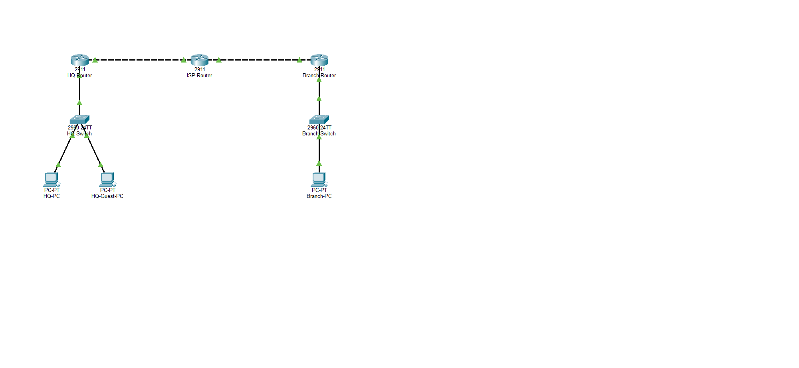

# 🛡️ Major Review Implementation Guide — Secure Multi-Branch Network with Site-to-Site IPsec VPN

> **Course:** Computer Networks (B.Tech / Undergraduate)  
> **Milestone:** Major Review (Part 1)  
> **Simulation Tool:** Cisco Packet Tracer (v8.0+ / v9.0+)  
> **Target Topology File:** [`Secure_MultiBranch_IPsec_VPN.pkt`](../Secure_MultiBranch_IPsec_VPN.pkt)

---

## 📑 Table of Contents
1. [Project Overview & Objectives](#1-project-overview--objectives)
2. [Topology Specification & Diagram](#2-topology-specification--diagram)
3. [Device Inventory & Connection Table](#3-device-inventory--connection-table)
4. [IP Addressing Plan](#4-ip-addressing-plan)
5. [Router Configurations](#5-router-configurations)
6. [Switch Configurations](#6-switch-configurations)
7. [Site-to-Site IPsec VPN Architecture](#7-site-to-site-ipsec-vpn-architecture)
8. [Access Control List (ACL) Security Policy](#8-access-control-list-acl-security-policy)
9. [Step-by-Step Packet Tracer Assembly & Testing Guide](#9-step-by-step-packet-tracer-assembly--testing-guide)
10. [Assumptions, Limitations & Unsupported Features](#10-assumptions-limitations--unsupported-features)
11. [Viva Voce Preparation & Key Questions](#11-viva-voce-preparation--key-questions)

---

## 1. Project Overview & Objectives

In modern enterprise networking, organizations operate multiple geographically dispersed offices that require confidential, tamper-proof inter-branch communication over public untrusted transit networks (such as the Internet or simulated ISP backbones).

The objective of this Major Review project is to implement a secure, deterministic, and verifiable multi-branch network simulation in Cisco Packet Tracer meeting the following criteria:
- **Inter-Office Connectivity:** Connect a Headquarter (HQ) LAN and a Branch Office LAN across a simulated third-party transit ISP router using static IP routing.
- **Site-to-Site IPsec VPN:** Establish an automated, crypto-map driven IPsec tunnel between the edge routers (`HQ-Router` and `Branch-Router`) protecting all private inter-office traffic.
- **Role-Based Access Control:** Enforce gateway-level Extended Access Control Lists (ACLs) to segregate authorized engineering/management workstations from unauthorized/guest terminals.
- **Zero VLAN Complexity:** Implement simple switch-based broadcast domains without VLANs, 802.1Q trunks, or sub-interfaces, ensuring strict adherence to the review boundary.
- **Measurable Verification:** Validate both control-plane (IKE ISAKMP SA in `QM_IDLE`) and data-plane (ESP `#pkts encaps` and `#pkts decaps`) security operations.

---

## 2. Topology Specification & Diagram

### 📸 Logical Topology Screenshot


### 📊 Logical Topology Diagram (Mermaid)

```mermaid
graph LR
    subgraph HQ_LAN ["HQ Office LAN (192.168.10.0/24)"]
        HQ_PC["HQ-PC<br/>192.168.10.10<br/>(Authorized)"] ---|Fa0 <--> Fa0/1| HQ_SW["HQ-Switch<br/>(Cisco 2960)"]
        HQ_GUEST["HQ-Guest-PC<br/>192.168.10.50<br/>(Unauthorized)"] ---|Fa0 <--> Fa0/2| HQ_SW
        HQ_SW ---|Gi0/1 <--> Gi0/0| HQ_R["HQ-Router<br/>(Cisco 2911)<br/>GW: 192.168.10.1"]
    end

    subgraph WAN_CORE ["Simulated Public ISP Transit"]
        ISP_R["ISP-Router<br/>(Cisco 2911 Transit)"]
        HQ_R ---|"Gi0/1 <--> Gi0/0<br/>203.0.113.0/30 (Cross Cable)"| ISP_R
        ISP_R ---|"Gi0/1 <--> Gi0/1<br/>198.51.100.0/30 (Cross Cable)"| BR_R["Branch-Router<br/>(Cisco 2911)<br/>GW: 192.168.20.1"]
    end

    subgraph BRANCH_LAN ["Branch Office LAN (192.168.20.0/24)"]
        BR_R ---|Gi0/0 <--> Gi0/1| BR_SW["Branch-Switch<br/>(Cisco 2960)"]
        BR_SW ---|Fa0/1 <--> Fa0| BR_PC["Branch-PC<br/>192.168.20.10<br/>(Branch Host)"]
    end

    linkStyle 3 stroke:#2ecc71,stroke-width:3px;
    linkStyle 4 stroke:#2ecc71,stroke-width:3px;

    classDef router fill:#3498db,stroke:#1d6fa5,stroke-width:2px,color:#fff;
    classDef switch fill:#9b59b6,stroke:#6c3483,stroke-width:2px,color:#fff;
    classDef pc fill:#1abc9c,stroke:#117864,stroke-width:2px,color:#fff;

    class HQ_R,ISP_R,BR_R router;
    class HQ_SW,BR_SW switch;
    class HQ_PC,HQ_GUEST,BR_PC pc;
```


---

## 3. Device Inventory & Connection Table

| Device Name | Hardware Model | Chassis Type | Interface | Connected To Device | Remote Interface | Cable Type |
| :--- | :--- | :--- | :--- | :--- | :--- | :--- |
| **`HQ-Router`** | Cisco 2911 | Integrated Services Router | `GigabitEthernet0/0` | `HQ-Switch` | `GigabitEthernet0/1` | Copper Straight-Through |
| **`HQ-Router`** | Cisco 2911 | Integrated Services Router | `GigabitEthernet0/1` | `ISP-Router` | `GigabitEthernet0/0` | Copper Crossover |
| **`ISP-Router`** | Cisco 2911 | Integrated Services Router | `GigabitEthernet0/0` | `HQ-Router` | `GigabitEthernet0/1` | Copper Crossover |
| **`ISP-Router`** | Cisco 2911 | Integrated Services Router | `GigabitEthernet0/1` | `Branch-Router` | `GigabitEthernet0/1` | Copper Crossover |
| **`Branch-Router`**| Cisco 2911 | Integrated Services Router | `GigabitEthernet0/1` | `ISP-Router` | `GigabitEthernet0/1` | Copper Crossover |
| **`Branch-Router`**| Cisco 2911 | Integrated Services Router | `GigabitEthernet0/0` | `Branch-Switch` | `GigabitEthernet0/1` | Copper Straight-Through |
| **`HQ-Switch`** | Cisco 2960-24TT | Layer 2 Switch | `FastEthernet0/1` | `HQ-PC` | `FastEthernet0` | Copper Straight-Through |
| **`HQ-Switch`** | Cisco 2960-24TT | Layer 2 Switch | `FastEthernet0/2` | `HQ-Guest-PC` | `FastEthernet0` | Copper Straight-Through |
| **`HQ-Switch`** | Cisco 2960-24TT | Layer 2 Switch | `GigabitEthernet0/1` | `HQ-Router` | `GigabitEthernet0/0` | Copper Straight-Through |
| **`Branch-Switch`**| Cisco 2960-24TT | Layer 2 Switch | `FastEthernet0/1` | `Branch-PC` | `FastEthernet0` | Copper Straight-Through |
| **`Branch-Switch`**| Cisco 2960-24TT | Layer 2 Switch | `GigabitEthernet0/1` | `Branch-Router` | `GigabitEthernet0/0` | Copper Straight-Through |
| **`HQ-PC`** | PC-PT | Standard Host Workstation | `FastEthernet0` | `HQ-Switch` | `FastEthernet0/1` | Copper Straight-Through |
| **`HQ-Guest-PC`** | PC-PT | Test Guest Workstation | `FastEthernet0` | `HQ-Switch` | `FastEthernet0/2` | Copper Straight-Through |
| **`Branch-PC`** | PC-PT | Standard Host Workstation | `FastEthernet0` | `Branch-Switch` | `FastEthernet0/1` | Copper Straight-Through |

---

## 4. IP Addressing Plan

The addressing scheme strictly complies with the specification:

| Device / Host | Interface | IP Address | Subnet Mask | Default Gateway | Network Purpose |
| :--- | :--- | :--- | :--- | :--- | :--- |
| **`HQ-Router`** | `Gi0/0` | `192.168.10.1` | `255.255.255.0` (/24) | N/A | HQ Office LAN Gateway |
| **`HQ-Router`** | `Gi0/1` | `203.0.113.2` | `255.255.255.252` (/30) | `203.0.113.1` | HQ WAN Public Interface |
| **`HQ-PC`** | `FastEthernet0` | `192.168.10.10` | `255.255.255.0` (/24) | `192.168.10.1` | Authorized Management Host |
| **`HQ-Guest-PC`** | `FastEthernet0` | `192.168.10.50` | `255.255.255.0` (/24) | `192.168.10.1` | Unauthorized / Guest Host |
| **`ISP-Router`** | `Gi0/0` | `203.0.113.1` | `255.255.255.252` (/30) | N/A | ISP Gateway towards HQ |
| **`ISP-Router`** | `Gi0/1` | `198.51.100.1` | `255.255.255.252` (/30) | N/A | ISP Gateway towards Branch |
| **`Branch-Router`**| `Gi0/1` | `198.51.100.2` | `255.255.255.252` (/30) | `198.51.100.1` | Branch WAN Public Interface |
| **`Branch-Router`**| `Gi0/0` | `192.168.20.1` | `255.255.255.0` (/24) | N/A | Branch Office LAN Gateway |
| **`Branch-PC`** | `FastEthernet0` | `192.168.20.10` | `255.255.255.0` (/24) | `192.168.20.1` | Branch Test Endpoint |

---

## 5. Router Configurations

All startup configurations are persisted in [`configs/`](../configs/):

### 1. `HQ-Router` (`configs/HQ-Router.cfg`)
```cisco
hostname HQ-Router
!
! Activate Security Technology Package (Required for Crypto on Cisco 2911)
license boot module c2900 technology-package securityk9
!
! ISAKMP Phase 1 Policy
crypto isakmp policy 10
 encr aes
 hash sha
 authentication pre-share
 group 2
 lifetime 86400
!
! Pre-shared Secret for Branch Peer
crypto isakmp key ciscoVPN2026 address 198.51.100.2
!
! IPsec Phase 2 Transform Set
crypto ipsec transform-set VPN-TS esp-aes esp-sha-hmac
 mode tunnel
!
! Crypto Map Definition
crypto map VPN-MAP 10 ipsec-isakmp 
 set peer 198.51.100.2
 set transform-set VPN-TS 
 match address 101
!
! LAN Interface with Gateway ACL Filter
interface GigabitEthernet0/0
 description HQ Internal LAN Gateway
 ip address 192.168.10.1 255.255.255.0
 ip access-group 110 in
 no shutdown
!
! WAN Interface with Crypto Map Binding
interface GigabitEthernet0/1
 description WAN Link to ISP
 ip address 203.0.113.2 255.255.255.252
 crypto map VPN-MAP
 no shutdown
!
! Static Default Route towards ISP Gateway
ip route 0.0.0.0 0.0.0.0 203.0.113.1
!
! Interesting Traffic ACL for Crypto Map
access-list 101 permit ip 192.168.10.0 0.0.0.255 192.168.20.0 0.0.0.255
!
! Role-Based Access Control List (Applied Inbound on Gi0/0)
access-list 110 deny ip host 192.168.10.50 192.168.20.0 0.0.0.255
access-list 110 permit ip 192.168.10.0 0.0.0.255 192.168.20.0 0.0.0.255
access-list 110 permit ip any any
```

### 2. `Branch-Router` (`configs/Branch-Router.cfg`)
```cisco
hostname Branch-Router
!
! Activate Security Technology Package
license boot module c2900 technology-package securityk9
!
! ISAKMP Phase 1 Policy (Matching HQ-Router)
crypto isakmp policy 10
 encr aes
 hash sha
 authentication pre-share
 group 2
 lifetime 86400
!
! Pre-shared Secret for HQ Peer
crypto isakmp key ciscoVPN2026 address 203.0.113.2
!
! IPsec Phase 2 Transform Set
crypto ipsec transform-set VPN-TS esp-aes esp-sha-hmac
 mode tunnel
!
! Crypto Map Definition
crypto map VPN-MAP 10 ipsec-isakmp 
 set peer 203.0.113.2
 set transform-set VPN-TS 
 match address 101
!
! LAN Interface
interface GigabitEthernet0/0
 description Branch Internal LAN Gateway
 ip address 192.168.20.1 255.255.255.0
 no shutdown
!
! WAN Interface with Crypto Map Binding
interface GigabitEthernet0/1
 description WAN Link to ISP
 ip address 198.51.100.2 255.255.255.252
 crypto map VPN-MAP
 no shutdown
!
! Static Default Route towards ISP Gateway
ip route 0.0.0.0 0.0.0.0 198.51.100.1
!
! Interesting Traffic ACL for Crypto Map
access-list 101 permit ip 192.168.20.0 0.0.0.255 192.168.10.0 0.0.0.255
```

### 3. `ISP-Router` (`configs/ISP-Router-VPN.cfg`)
```cisco
hostname ISP-Router
!
interface GigabitEthernet0/0
 description Link to HQ-Router WAN
 ip address 203.0.113.1 255.255.255.252
 no shutdown
!
interface GigabitEthernet0/1
 description Link to Branch-Router WAN
 ip address 198.51.100.1 255.255.255.252
 no shutdown
!
! Static routes to allow unencrypted transit test (Test A) and routing between WAN subnets
ip route 192.168.10.0 255.255.255.0 203.0.113.2
ip route 192.168.20.0 255.255.255.0 198.51.100.2
```

---

## 6. Switch Configurations

Both switches operate as simple transparent Layer 2 access switches.
- **No VLAN features, no trunking, and no inter-VLAN routing** are configured.
- Default VLAN 1 untagged access ports are used throughout.

Configurations:
- [`configs/HQ-Switch.cfg`](../configs/HQ-Switch.cfg)
- [`configs/Branch-Switch.cfg`](../configs/Branch-Switch.cfg)

---

## 7. Site-to-Site IPsec VPN Architecture

### Phase 1: Internet Key Exchange (IKE / ISAKMP)
- **Role:** Securely authenticates the two router endpoints and negotiates an encrypted bidirectionally authenticated management channel.
- **Policy Parameters:**
  - **Encryption Algorithm:** Advanced Encryption Standard (AES 128-bit)
  - **Hashing Algorithm:** Secure Hash Algorithm 1 (SHA-1)
  - **Authentication:** Pre-Shared Key (`ciscoVPN2026`)
  - **Key Exchange:** Diffie-Hellman Group 2 (1024-bit modulus)
  - **SA Lifetime:** 86,400 seconds (24 hours)

### Phase 2: IP Security (IPsec)
- **Role:** Negotiates the unidirectional Security Associations (SAs) used to encapsulate, encrypt, and authenticate the payload data.
- **Transform Set:** `VPN-TS`
  - Encapsulating Security Payload (ESP) Encryption: `esp-aes`
  - ESP Authentication / Integrity: `esp-sha-hmac`
  - Encapsulation Mode: `Tunnel` (Original IP packet is wrapped in a new IP header with public endpoints `203.0.113.2` and `198.51.100.2`)
- **Crypto Map:** Bound directly to egress WAN interfaces (`GigabitEthernet0/1`), intercepting packets matching ACL 101.

---

## 8. Access Control List (ACL) Security Policy

### Rationale and Placement
Security policies should be applied **as close to the source as possible** to discard unauthorized packets before they consume router CPU, bandwidth, or crypto processing power.

### Implementation:
On `HQ-Router`, `access-list 110` is applied **inbound on `GigabitEthernet0/0`**:

```cisco
access-list 110 deny ip host 192.168.10.50 192.168.20.0 0.0.0.255
access-list 110 permit ip 192.168.10.0 0.0.0.255 192.168.20.0 0.0.0.255
access-list 110 permit ip any any
```

### Flow Behavior:
1. **`HQ-PC` (`192.168.10.10`)**:
   - Matches rule 20 (`permit ip 192.168.10.0 ... 192.168.20.0 ...`).
   - Packets proceed to routing table -> routed out `Gi0/1`.
   - Packet matches crypto map ACL 101 -> encrypted into ESP tunnel -> delivered to `Branch-PC`.
2. **`HQ-Guest-PC` (`192.168.10.50`)**:
   - Matches rule 10 (`deny ip host 192.168.10.50 ... 192.168.20.0 ...`).
   - Dropped immediately at gateway `192.168.10.1`.
   - Router replies with ICMP `Destination host unreachable`.
   - Never hits routing table, never touches crypto map, IPsec packet counters do not increment.

---

## 9. Step-by-Step Packet Tracer Assembly & Testing Guide

If assembling the simulation manually from scratch in Packet Tracer:

### Step 1: Place Devices on Canvas
1. Add three **Cisco 2911 Routers**: `HQ-Router`, `ISP-Router`, `Branch-Router`.
2. Add two **Cisco 2960-24TT Switches**: `HQ-Switch`, `Branch-Switch`.
3. Add three **Generic PCs (PC-PT)**: `HQ-PC`, `HQ-Guest-PC`, `Branch-PC`.

### Step 2: Cable the Topology
1. Connect `HQ-Router` `Gi0/1` to `ISP-Router` `Gi0/0` using a **Crossover cable**.
2. Connect `ISP-Router` `Gi0/1` to `Branch-Router` `Gi0/1` using a **Crossover cable**.
3. Connect `HQ-Router` `Gi0/0` to `HQ-Switch` `Gi0/1` using a **Straight-Through cable**.
4. Connect `HQ-Switch` `Fa0/1` to `HQ-PC` `Fa0` using a **Straight-Through cable**.
5. Connect `HQ-Switch` `Fa0/2` to `HQ-Guest-PC` `Fa0` using a **Straight-Through cable**.
6. Connect `Branch-Router` `Gi0/0` to `Branch-Switch` `Gi0/1` using a **Straight-Through cable**.
7. Connect `Branch-Switch` `Fa0/1` to `Branch-PC` `Fa0` using a **Straight-Through cable**.

### Step 3: Activate Security License on Routers
On both `HQ-Router` and `Branch-Router`:
```cisco
Router> enable
Router# configure terminal
Router(config)# license boot module c2900 technology-package securityk9
! Type 'yes' to accept the EULA
Router(config)# exit
Router# write memory
Router# reload
! Press Return after reboot
```

### Step 4: Configure IP Addresses & Routing
Paste the configurations from Section 5 into `HQ-Router`, `ISP-Router`, and `Branch-Router`.

### Step 5: Configure PCs
- **`HQ-PC`:** IP `192.168.10.10`, Mask `255.255.255.0`, Gateway `192.168.10.1`
- **`HQ-Guest-PC`:** IP `192.168.10.50`, Mask `255.255.255.0`, Gateway `192.168.10.1`
- **`Branch-PC`:** IP `192.168.20.10`, Mask `255.255.255.0`, Gateway `192.168.20.1`

### Step 6: Execute Verification Suite
1. **Ping Test from `HQ-PC`:**
   Open Desktop -> Command Prompt on `HQ-PC`:
   ```cmd
   ping 192.168.20.10
   ```
   *Expected:* 4 replies received (0% loss).
2. **Verify SA on `HQ-Router`:**
   ```cisco
   show crypto isakmp sa
   show crypto ipsec sa
   ```
   *Expected:* `QM_IDLE ACTIVE`, `#pkts encaps > 0`.
3. **ACL Filter Test from `HQ-Guest-PC`:**
   Open Desktop -> Command Prompt on `HQ-Guest-PC`:
   ```cmd
   ping 192.168.20.10
   ```
   *Expected:* `Reply from 192.168.10.1: Destination host unreachable` (100% loss).
4. **Verify ACL Matches on `HQ-Router`:**
   ```cisco
   show access-lists
   ```
   *Expected:* Deny matches = 4, Permit matches = 8.

---

## 10. Assumptions, Limitations & Unsupported Features

### 1. Cisco Packet Tracer Limitations:
- **IOS Command Piping (`|`)**: Cisco Packet Tracer does not support the Unix-style pipe filter (`| include` or `| section`) on crypto inspection commands. Run `show crypto ipsec sa` and `show access-lists` directly.
- **ISAKMP Main Mode vs Aggressive Mode**: Packet Tracer supports IKEv1 Main Mode and Quick Mode. IKEv2 is not supported on 2911/1941 models in PT.
- **License Boot Requirement**: In Cisco IOS 15 (ISR G2 series like 2911/1941), cryptographic commands (`crypto isakmp`, `crypto ipsec`) are locked under the `securityk9` evaluation license. The command `license boot module c2900 technology-package securityk9` followed by `write` and `reload` is mandatory.
- **NAT Traversal (NAT-T)**: In this topology, no intermediate NAT device exists along the transit link; therefore, ESP (IP Protocol 50) traverses the simulated ISP without UDP encapsulation (port 4500).

### 2. Assumptions:
- Public IPs `203.0.113.0/30` and `198.51.100.0/30` are standard RFC 5737 documentation prefixes used for simulation.
- Switches operate as pure Layer 2 pass-through devices with Spanning Tree Protocol (PVST+) enabled.

---

## 11. Viva Voce Preparation & Key Questions

### Q1: What is the purpose of an IPsec site-to-site VPN?
**Answer:** A Site-to-Site IPsec VPN securely connects two physically distant local area networks (LANs) across an unsecure public network (like the Internet). It provides three core security services:
1. **Confidentiality:** Encryption (AES) protects data from eavesdropping.
2. **Integrity:** Hashing (SHA) ensures data has not been modified in transit.
3. **Authentication:** Pre-shared keys (or digital certificates) authenticate the identity of the remote router peer.

### Q2: What are the two phases of IKE/IPsec?
**Answer:**
- **IKE Phase 1 (ISAKMP):** Negotiates a bidirectional, authenticated, encrypted channel (IKE SA) between the two router peers using Diffie-Hellman key exchange. The resulting state on Cisco routers is `QM_IDLE`.
- **IKE Phase 2 (IPsec SA):** Negotiates unidirectional security associations (one inbound, one outbound) that define how user data traffic matching the interesting traffic ACL is encapsulated and encrypted using ESP.

### Q3: Why is a successful ping not enough proof that a VPN is working?
**Answer:** Because if routing exists through the ISP, unencrypted ICMP packets could simply be forwarded in plain text. Proof of VPN encryption requires inspecting the router using `show crypto ipsec sa` and verifying that the `#pkts encaps` and `#pkts decaps` counters increment when packets flow.

### Q4: What is the role of the "Interesting Traffic" ACL?
**Answer:** The interesting traffic ACL (`access-list 101 permit ip 192.168.10.0 ... 192.168.20.0 ...`) tells the crypto map which packets must be intercepted, encrypted into an ESP packet, and sent across the VPN tunnel, versus packets that should be forwarded normally as unencrypted plain text.

### Q5: Why was the security ACL applied inbound on `GigabitEthernet0/0` instead of the WAN interface?
**Answer:** Applying the ACL inbound on the LAN gateway interface follows Cisco best practices by dropping unauthorized traffic immediately as it enters the router. This prevents unauthorized packets from consuming router memory, routing table lookup cycles, and crypto map processing.
