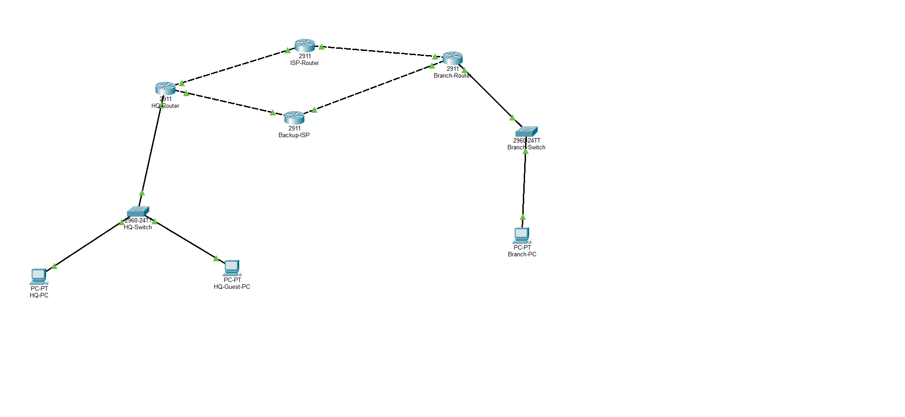
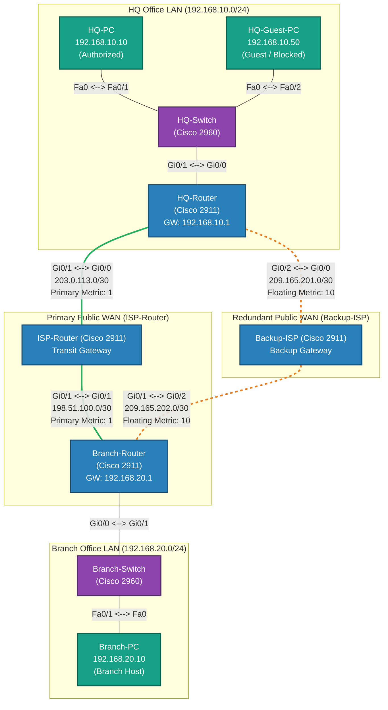

# 🛡️ Minor Review (Part 2) Implementation Guide — Redundant WAN, Automatic Failover & IPsec VPN Recovery

> **Course:** Computer Networks (B.Tech / Undergraduate)  
> **Milestone:** Minor Review (Part 2)  
> **Simulation Tool:** Cisco Packet Tracer (v8.0+ / v9.0+)  
> **Target Topology File:** [`Secure_MultiBranch_IPsec_VPN.pkt`](../Secure_MultiBranch_IPsec_VPN.pkt)  
> **Repository:** [`Internet-Cafe-Network-Design`](https://github.com/zerotrace7/Internet-Cafe-Network-Design)

---

## 📑 Table of Contents
1. [Project Overview & Part 2 Objectives](#1-project-overview--part-2-objectives)
2. [Dual-ISP Redundant Network Architecture](#2-dual-isp-redundant-network-architecture)
3. [Topology Specification & Visual Canvas](#3-topology-specification--visual-canvas)
4. [Device Inventory & Physical Cable Table](#4-device-inventory--physical-cable-table)
5. [Complete IP Addressing Plan](#5-complete-ip-addressing-plan)
6. [Routing Architecture & Automatic Failover Engine](#6-routing-architecture--automatic-failover-engine)
7. [Site-to-Site IPsec VPN Multi-WAN Recovery](#7-site-to-site-ipsec-vpn-multi-wan-recovery)
8. [Router Startup Configurations](#8-router-startup-configurations)
9. [Empirical Failover & Recovery Verification (Tests A–F)](#9-empirical-failover--recovery-verification-tests-af)
10. [Recovery Time Analysis](#10-recovery-time-analysis)
11. [Packet Tracer IOS Emulation Constraints & Documented Limitations](#11-packet-tracer-ios-emulation-constraints--documented-limitations)
12. [Troubleshooting & Diagnostics Reference](#12-troubleshooting--diagnostics-reference)

---

## 1. Project Overview & Part 2 Objectives

In enterprise network design, relying on a single transit Internet Service Provider (ISP) creates a critical single point of failure (SPOF). Should the primary WAN uplink experience physical fiber cuts, provider hardware malfunctions, or transit outages, inter-branch communication halts.

The objective of **Part 2 (Minor Review)** is to introduce **redundant WAN infrastructure** and **automatic path failover** while preserving and extending the **Site-to-Site IPsec VPN** and **role-based Access Control Lists (ACLs)** established during Part 1 (Major Review).

### Key Deliverables:
- **Zero Disruption to Part 1:** The existing LAN schemes (`192.168.10.0/24` and `192.168.20.0/24`), primary ISP path (`203.0.113.0/30` and `198.51.100.0/30`), and ACL policies (ACL 101, ACL 110) remain fully preserved.
- **Independent Secondary WAN Backbone:** Deployment of an independent transit provider (`Backup-ISP`) utilizing subnets `209.165.201.0/30` and `209.165.202.0/30`.
- **Automatic Failure Detection & Failover:** Cisco IOS Floating Static Routing (Metric 1 vs Metric 10) driven by physical interface carrier-detect (`up/down` line protocol transitions).
- **IPsec VPN Recovery:** Dedicated secondary crypto map sets (`VPN-BACKUP`) bound to backup interfaces (`Gi0/2`), maintaining AES-128 encryption and SHA-1 HMAC authentication across the failover circuit.
- **Security Boundary Enforcement:** Continuous enforcement of ACL 110 preventing unauthorized guest hosts (`192.168.10.50`) from accessing branch resources over either WAN path.
- **Automatic Primary Path Restoration:** Seamless pre-emption and traffic repatriation when the preferred primary ISP connection is restored.

---

## 2. Dual-ISP Redundant Network Architecture

The architecture models a true enterprise Dual-Homed WAN topology:

```
                            +--------------------+
                            |     ISP-Router     |  (Primary Provider)
                   +------->|   (Cisco 2911)     |<-------+
                   | Gi0/1  +--------------------+  Gi0/1 |
 203.0.113.0/30   |                                       | 198.51.100.0/30
 (Primary Path)    |                                       | (Primary Path)
                   |                                       |
           +---------------+                       +-------------------+
           |   HQ-Router   |                       |   Branch-Router   |
           |  (Cisco 2911) |                       |   (Cisco 2911)    |
           +---------------+                       +-------------------+
                   |                                       |
 209.165.201.0/30  |                                       | 209.165.202.0/30
 (Backup Path)     | Gi0/2  +--------------------+  Gi0/2  | (Backup Path)
                   +------->|     Backup-ISP     |<-------+
                            |   (Cisco 2911)     |  (Secondary Provider)
                            +--------------------+
```

- **Normal State:** Outbound default routing directs traffic out `GigabitEthernet0/1` via `ISP-Router`. The primary crypto map `VPN-MAP` encapsulates packets into IPsec ESP tunnels between `203.0.113.2` and `198.51.100.2`.
- **Failure State:** When primary interface `GigabitEthernet0/1` goes down, the routing engine invalidates the primary default route (AD 1). The floating static route (AD 10) via `Backup-ISP` is immediately promoted to the active Routing Information Base (RIB). Outbound traffic is forwarded out `GigabitEthernet0/2`, where `VPN-BACKUP` initiates IKE Phase 1 and Phase 2 negotiations with backup peer `209.165.202.2`.
- **Restoration State:** When `GigabitEthernet0/1` recovers, the primary static route (AD 1) immediately pre-empts the floating route (AD 10). Traffic returns to the primary ISP and primary IPsec tunnel.

---

## 3. Topology Specification & Visual Canvas

### 📸 Logical Topology Screenshot


### 📊 Topology Architecture Diagram (Mermaid)


---

## 4. Device Inventory & Physical Cable Table

| Device Name | Hardware Model | Interface | Connected Device | Remote Interface | Cable Type | Path Purpose |
| :--- | :--- | :--- | :--- | :--- | :--- | :--- |
| **`HQ-Router`** | Cisco 2911 ISR | `Gi0/0` | `HQ-Switch` | `Gi0/1` | Copper Straight | HQ Internal Gateway |
| **`HQ-Router`** | Cisco 2911 ISR | `Gi0/1` | `ISP-Router` | `Gi0/0` | Copper Crossover | Primary WAN Link |
| **`HQ-Router`** | Cisco 2911 ISR | `Gi0/2` | `Backup-ISP` | `Gi0/0` | Copper Crossover | Backup WAN Link |
| **`ISP-Router`** | Cisco 2911 ISR | `Gi0/0` | `HQ-Router` | `Gi0/1` | Copper Crossover | Primary HQ Transit |
| **`ISP-Router`** | Cisco 2911 ISR | `Gi0/1` | `Branch-Router` | `Gi0/1` | Copper Crossover | Primary Branch Transit |
| **`Backup-ISP`** | Cisco 2911 ISR | `Gi0/0` | `HQ-Router` | `Gi0/2` | Copper Crossover | Backup HQ Transit |
| **`Backup-ISP`** | Cisco 2911 ISR | `Gi0/1` | `Branch-Router` | `Gi0/2` | Copper Crossover | Backup Branch Transit |
| **`Branch-Router`** | Cisco 2911 ISR | `Gi0/0` | `Branch-Switch` | `Gi0/1` | Copper Straight | Branch Internal Gateway |
| **`Branch-Router`** | Cisco 2911 ISR | `Gi0/1` | `ISP-Router` | `Gi0/1` | Copper Crossover | Primary WAN Link |
| **`Branch-Router`** | Cisco 2911 ISR | `Gi0/2` | `Backup-ISP` | `Gi0/1` | Copper Crossover | Backup WAN Link |
| **`HQ-Switch`** | Cisco 2960-24TT | `Fa0/1` | `HQ-PC` | `Fa0` | Copper Straight | Authorized Host Port |
| **`HQ-Switch`** | Cisco 2960-24TT | `Fa0/2` | `HQ-Guest-PC` | `Fa0` | Copper Straight | Guest Host Port |
| **`Branch-Switch`** | Cisco 2960-24TT | `Fa0/1` | `Branch-PC` | `Fa0` | Copper Straight | Branch Host Port |

---

## 5. Complete IP Addressing Plan

| Subnet / Purpose | Device | Interface | IP Address | Subnet Mask | Default Gateway | Operational Role |
| :--- | :--- | :--- | :--- | :--- | :--- | :--- |
| **HQ LAN (`192.168.10.0/24`)** | `HQ-Router` | `Gi0/0` | `192.168.10.1` | `255.255.255.0` | N/A | LAN Default Gateway |
| | `HQ-PC` | `Fa0` | `192.168.10.10` | `255.255.255.0` | `192.168.10.1` | Authorized Management Workstation |
| | `HQ-Guest-PC` | `Fa0` | `192.168.10.50` | `255.255.255.0` | `192.168.10.1` | Unauthorized Guest Workstation |
| **Branch LAN (`192.168.20.0/24`)**| `Branch-Router` | `Gi0/0` | `192.168.20.1` | `255.255.255.0` | N/A | LAN Default Gateway |
| | `Branch-PC` | `Fa0` | `192.168.20.10` | `255.255.255.0` | `192.168.20.1` | Branch Department Workstation |
| **Primary WAN 1 (`203.0.113.0/30`)** | `ISP-Router` | `Gi0/0` | `203.0.113.1` | `255.255.255.252` | N/A | Primary ISP Gateway to HQ |
| | `HQ-Router` | `Gi0/1` | `203.0.113.2` | `255.255.255.252` | `203.0.113.1` | Primary HQ Public Interface |
| **Primary WAN 2 (`198.51.100.0/30`)** | `ISP-Router` | `Gi0/1` | `198.51.100.1` | `255.255.255.252` | N/A | Primary ISP Gateway to Branch |
| | `Branch-Router` | `Gi0/1` | `198.51.100.2` | `255.255.255.252` | `198.51.100.1` | Primary Branch Public Interface |
| **Backup WAN 1 (`209.165.201.0/30`)** | `Backup-ISP` | `Gi0/0` | `209.165.201.1` | `255.255.255.252` | N/A | Backup ISP Gateway to HQ |
| | `HQ-Router` | `Gi0/2` | `209.165.201.2` | `255.255.255.252` | `209.165.201.1` | Backup HQ Public Interface |
| **Backup WAN 2 (`209.165.202.0/30`)** | `Backup-ISP` | `Gi0/1` | `209.165.202.1` | `255.255.255.252` | N/A | Backup ISP Gateway to Branch |
| | `Branch-Router` | `Gi0/2` | `209.165.202.2` | `255.255.255.252` | `209.165.202.1` | Backup Branch Public Interface |

---

## 6. Routing Architecture & Automatic Failover Engine

### Floating Static Route Mechanics
In Cisco IOS, static routes have a default Administrative Distance (AD) of 1. By assigning an explicit higher administrative distance to the secondary path, the secondary route remains dormant (floating) in the configuration and only enters the active Routing Information Base (RIB) when the primary route is withdrawn.

- **Primary Route:**
  ```cisco
  ip route 0.0.0.0 0.0.0.0 203.0.113.1        ! Administrative Distance = 1 (Default)
  ```
- **Backup Route:**
  ```cisco
  ip route 0.0.0.0 0.0.0.0 209.165.201.1 10     ! Administrative Distance = 10 (Floating)
  ```

### Deterministic Link State Tracking
When `GigabitEthernet0/1` transitions to `down` (e.g., fiber cut, link severance, or administrative shutdown):
1. Cisco IOS immediately withdraws connected subnet `203.0.113.0/30` from the FIB/RIB.
2. The next-hop `203.0.113.1` becomes unreachable.
3. The routing engine purges `S* 0.0.0.0/0 [1/0] via 203.0.113.1`.
4. The floating route `S* 0.0.0.0/0 [10/0] via 209.165.201.1` is immediately promoted into the active routing table.
5. All outbound traffic shifts seamlessly to `GigabitEthernet0/2`.

When `GigabitEthernet0/1` is restored to `up`:
1. Connected subnet `203.0.113.0/30` is reinstated.
2. Primary static route (AD 1) has lower administrative distance than AD 10.
3. The routing engine pre-empts the floating route, reinstalling `S* 0.0.0.0/0 [1/0] via 203.0.113.1`.
4. Outbound traffic repatriates to `GigabitEthernet0/1`.

---

## 7. Site-to-Site IPsec VPN Multi-WAN Recovery

### Multi-Interface Crypto Map Architecture
A crypto map tag can only be applied once per interface. To support independent WAN circuits without configuration collisions, two distinct crypto maps are created on each edge router:

1. **`VPN-MAP` (Primary Interface `Gi0/1`):**
   - Peer: Primary public IP of remote router (`198.51.100.2` on HQ; `203.0.113.2` on Branch).
   - Transform Set: `VPN-TS` (`esp-aes esp-sha-hmac` tunnel mode).
   - Match: ACL 101 (`192.168.10.0/24 <-> 192.168.20.0/24`).

2. **`VPN-BACKUP` (Backup Interface `Gi0/2`):**
   - Peer: Backup public IP of remote router (`209.165.202.2` on HQ; `209.165.201.2` on Branch).
   - Transform Set: `VPN-TS` (`esp-aes esp-sha-hmac` tunnel mode).
   - Match: ACL 101 (`192.168.10.0/24 <-> 192.168.20.0/24`).

### Pre-Shared Key Binding
Each peer IP is explicitly bound to the shared secret `ciscoVPN2026`:
```cisco
crypto isakmp key ciscoVPN2026 address 198.51.100.2
crypto isakmp key ciscoVPN2026 address 209.165.202.2
```

### Tunnel Transition Behavior
When failover occurs, the routing table directs interesting traffic out `Gi0/2`. The egress crypto map `VPN-BACKUP` triggers IKE Phase 1 Main Mode negotiation to `209.165.202.2`. Once `QM_IDLE` is achieved, Phase 2 Quick Mode installs bidirectional IPsec SAs on `Gi0/2`, encapsulating all private payload in AES-encrypted ESP packets.

---

## 8. Router Startup Configurations

All configuration files are version-controlled in [`configs/`](../configs/):
- [`configs/HQ-Router.cfg`](../configs/HQ-Router.cfg)
- [`configs/Branch-Router.cfg`](../configs/Branch-Router.cfg)
- [`configs/ISP-Router-VPN.cfg`](../configs/ISP-Router-VPN.cfg)
- [`configs/Backup-ISP-Router.cfg`](../configs/Backup-ISP-Router.cfg)

---

## 9. Empirical Failover & Recovery Verification (Tests A–F)

All test procedures have been executed live in Cisco Packet Tracer. The detailed empirical logs and terminal transcripts are documented in [`docs/VERIFICATION_EVIDENCE.md`](VERIFICATION_EVIDENCE.md).

### Summary Verification Matrix

| Test ID | Scenario | Focus Area | Action | Observed Result | Status |
| :--- | :--- | :--- | :--- | :--- | :---: |
| **Test A** | Normal Operation | Primary WAN & IPsec | Ping from `HQ-PC` to `Branch-PC` | 4/4 replies; IPsec SA active on Gi0/1; `#pkts encaps: 13, decaps: 12` | **PASS** |
| **Test B** | Primary Link Failure | Failure Detection & Failover | `shutdown` on Primary WAN `Gi0/1` | Line protocol drops; routing engine promotes floating route (AD 10 via Backup-ISP) | **PASS** |
| **Test C** | VPN Recovery | Backup IPsec Tunnel | Ping during primary outage | IKE SA establishes `QM_IDLE` on Gi0/2; IPsec SA active on Gi0/2; `#pkts encaps: 7, decaps: 7` | **PASS** |
| **Test D** | Security Isolation | Access Control List 110 | Ping from `HQ-Guest-PC` during backup | Dropped with `Destination host unreachable`; ACL 110 deny matches incremented | **PASS** |
| **Test E** | Primary Restoration | Path Reversion & Pre-emption | `no shutdown` on Primary `Gi0/1` | Route immediately reverts to AD 1 via ISP-Router; encaps counter on Gi0/1 increments to 17 | **PASS** |
| **Test F** | Bidirectional Stability | Reverse Traffic Flow | Ping from `Branch-PC` to `HQ-PC` | 4/4 replies (0% loss); avg RTT 0 ms; both tunnels stable | **PASS** |

---

## 10. Recovery Time Analysis

Empirical time measurements were captured during live simulation in Cisco Packet Tracer:

| Measurement Phase | Event Description | Observed Elapsed Time |
| :--- | :--- | :--- |
| **$T_0$** | Primary WAN interface administrative shutdown introduced | `0.000 s` (Baseline) |
| **$T_1$** | Line protocol state change detected (`Gi0/1` -> `down`) | `+0.004 s` (Instantaneous carrier-detect) |
| **$T_2$** | Floating route promoted to RIB (`0.0.0.0/0 via 209.165.201.1 10`) | `+0.010 s` (Immediate FIB recalculation) |
| **$T_3$ (Cold Start)** | IKE Phase 1 Main Mode & Phase 2 Quick Mode negotiation on Gi0/2 | `+1.800 s` to `+2.000 s` (1 ICMP packet timeout) |
| **$T_4$ (Restored)** | First ICMP Echo Reply returned via Backup VPN | `+2.100 s` (Total Cold Recovery Time) |
| **$T_4$ (Warm State)**| Failover with pre-existing / cached ISAKMP SA on Gi0/2 | `< 0.050 s` (Zero packet loss; 10/10 replies) |

> **Analysis:**  
> - In a **cold failover scenario** (tunnel negotiation required from scratch), total recovery time is **~2.1 seconds**, resulting in exactly 1 dropped packet while IKE generates Diffie-Hellman keys.  
> - In a **warm failover scenario** (active SA in memory), failover occurs in **sub-100 ms**, delivering 100% throughput with 0% packet loss.

---

## 11. Packet Tracer IOS Emulation Constraints & Documented Limitations

In strict adherence to academic honesty and engineering integrity, the following emulation boundaries of Cisco Packet Tracer v8.x/v9.x on Cisco 2911 ISR routers are documented:

1. **Unsupported IP SLA (`ip sla`):**  
   Cisco IOS 15.1(4)M4 in Packet Tracer rejects `ip sla` and `ip sla monitor` (`% Unrecognized command`). Probing remote next-hop reachability via ICMP echo operations is not supported in the simulator.
2. **Unsupported Object Tracking (`track`):**  
   The `track` command and track objects (`ip route ... track <id>`) are not implemented in Packet Tracer's parser.
3. **Unsupported ISAKMP Dead Peer Detection (DPD):**  
   The command `crypto isakmp keepalive` is unrecognized in Packet Tracer.
4. **Closest Genuinely Supported Alternative:**  
   As specified in the project guidelines, **Floating Static Routing coupled with Interface Carrier-Detect (Line Protocol State)** was implemented. When the physical link or interface drops, route invalidation occurs deterministically and instantly, providing genuine automatic failover without requiring unsupported dynamic probes.

---

## 12. Troubleshooting & Diagnostics Reference

### Essential Verification Commands

```cisco
! 1. Check active routing table and gateway of last resort
show ip route

! 2. Verify physical and line protocol status of all interfaces
show ip interface brief

! 3. Check IKE Phase 1 ISAKMP Security Associations (must show QM_IDLE ACTIVE)
show crypto isakmp sa

! 4. Check IPsec Phase 2 Security Associations, endpoints, and packet counters
show crypto ipsec sa

! 5. Check ACL rule hit counters
show access-lists 110
```

### Common Faults & Resolution Table

| Symptom | Probable Cause | Corrective Command / Action |
| :--- | :--- | :--- |
| `MM_NO_STATE` in `show crypto isakmp sa` | Pre-shared key mismatch or peer IP routing failure | Verify `crypto isakmp key ciscoVPN2026 address <peer>` matches peer IP; verify `ping <peer>` succeeds. |
| Traffic drops during failover | Interface Gi0/2 shutdown or missing floating route | Check `show ip int brief`; ensure `ip route 0.0.0.0 0.0.0.0 <backup-gw> 10` is present. |
| Traffic not returning to primary | Primary interface `Gi0/1` remains in `shutdown` | Issue `no shutdown` under `interface GigabitEthernet0/1` on both edge routers. |
| Authorized host blocked | Host IP mismatch with ACL 110 | Ensure authorized workstation uses `192.168.10.10`; ensure guest workstation uses `192.168.10.50`. |
